* TOC
{:toc}

# 16. oktoober 2026, reede
_Costa del Silencio_

## Lõpuks kohal

Saabusime üleeile. Sõit ise oli meeldivalt sündmustevaene - lennujaama jõudsime võrdlemisi vara, sest teel takistusi ei olnud, ning lend läks ka üsna sujuvalt. Riias tehti küll natuke närvikõdi, kui hakati uurima, kas keegi tahaks oma reisiplaane muuta, sest lend on ülebroneeritud. Ma olen kuulnud, et nii võib juhtuda, aga ei olnud seda kunagi ise kogenud. Ega ma nüüd ei teagi, kes või mil määral vabatahtlikult maha jäi. Meil oli Erki fotoka tõttu raskem käsipagas ostetud ning sellega käis kaasas Priority Boarding, nii et saime oma kohad viperusteta kätte.
Lend oli öine - ma kadestasin kõiki neid inimesi, kes rahulikult põõnasid. Tukastasin ka aegajalt poole tunni või tunni kaupa, aga iga kord virgudes oli tunne, et olen veel unisem kui enne.

Kohale jõudsime 4:30 asemel lausa kell 4 (hommikul). Õues oli pime, aga soe. Miks ma tean, et õues oli pime, aga soe? Sest me käisime parklat mööda uitamas, et kontrollida, ega mõni autorendiputka avatud ei ole. Ma nimelt broneerisin kella 5-ks auto, aga lennujaama hoones olid kõik rendifirmade aknad, sh meie Cicar, pimedad. Helistasime klienditoele, kes ei vastanud. Parklas valitses tühjus (hea küll - autod olid; isegi üks kass auto katusel). Me polnud muidugi ainsad hädalised - ühtede eestlastega muljetasime seal pikalt, et mis strateegia valida. Lõpuks tõdesime, et meil võtaks ühistranspordiga majutusse saamine nii kaua aega, et peaks kohe hakkama tagasi auto järele tulema ning pole mõtet jahmerdada. Niisiis ootasime rõõmsalt kella 7-ni, mil kontor avati. Veidi liialdan - nad hakkasid oma pikka saba ikka oma viis kuni kümme minutit enne seitset teenindama ning meie lepingu peale sai isegi kellaaeg 6:59.

Kuna meie siinsesse koju sõites oli väljas kottpime, on mul siiamaani tunne, nagu me oleksime saabunud õhtul. Tegelikult tassisime oma kola tuppa, keerasime veekraani lahti, logisime internetti ning asusime tööle, sest Eestis oli kell juba tasapisi 10 saanud.

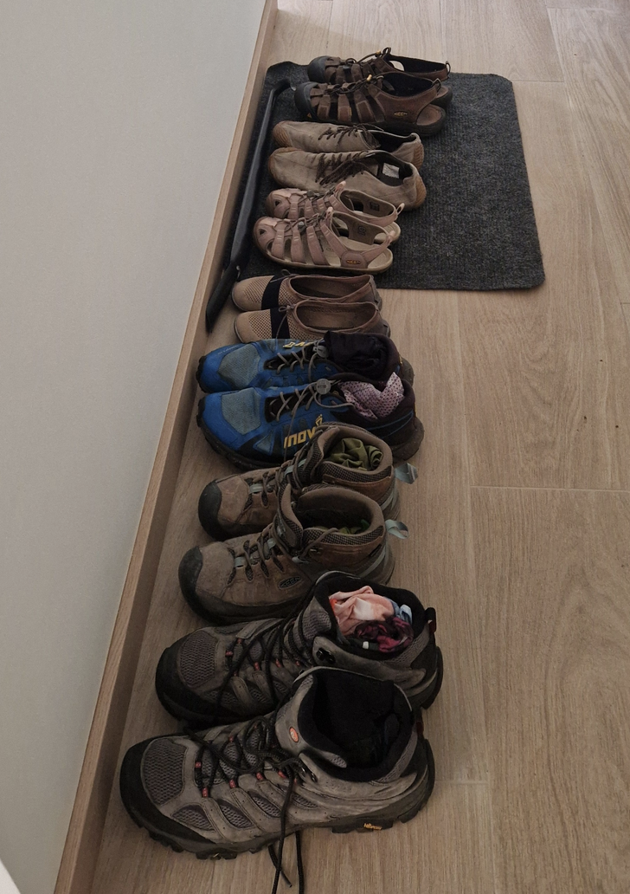{: .narrow}
_Sajajalgsed saabusid_

## Kolmapäev: torutööd ja poed

Pärast väikest meenutamist, milles mu töö seisnes (sest pea oli tegelikult ikka väga väsinud), läks hoopis kõht tühjaks ning guugeldasin, kust midagi hamba alla saada. Selgus, et ümber nurga on toidupood ning sellest paar sammu edasi nunnu võileivakohvik Vibras del Alma, kus võiku ootamise ajal riiulitel olevaid raamatuid sirvida sai. Hakkasin ühte otsast lugema, aga seni polegi jõudnud edasi lugema minna.

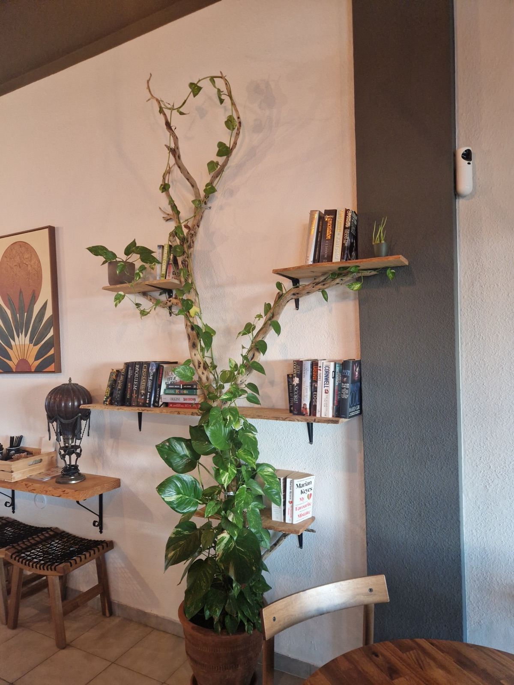
_Vibras des Alma_

Esimese päeva seiklused jätkusid torutööde koordineerimisega. Ses osas oli mind enne tulekut hoiatatud, et kõikides ridaelamuboksides plaanitakse majja sisse tulev vesi ühelt poolt maja teisele poole maja ringi tõsta. Lubati, et tehakse eelmisel nädalal, aga kuna siis ei olnud kippu ega kõppu, oli arvata, et tõenäoliselt hakkab meie siinoleku ajal asju juhtuma. Õnneks tekkis meil lõuna paiku huvi vett kasutada, tänu millele saime teada, et mida pole seda pole. (Ses mõttes, et hommikul oli vesi ilusti olemas.) Vastavalt peremehe juhtnööridele läksin õue torumeest otsima. Leidsingi ühe kuti, kes inglise keeles rääkimise oskuste kohta küsimise peale vastas, et "natukene". Igal juhul piisavalt, et sai aru, et ma tahan kangesti vett tagasi saada. Uitasime siis garaaži juurde, vaatasime torujupi üle. Edasi külastasime boileriruumi, kus torumees katsus torusid ning oli veendunud, et majja sisse tuleb üks, mis käega katsudes jahedam tundub. Ma ajasin nagu uni peale, et majja sisse tuleb ikkagi see toru, mis on paremal pool teistest eraldi ning mille juurde on pandud silt, et see on majja sisenev peamine veetoru. Pärast seda kui lubasin omanikule helistada ning üle küsida, arvas töömees, et ju mul on ikka õigus. Kui ta seal hiljem seina auku puuris ja toru vedas, siis käisin ikkagi igaks juhuks piilumas, kas ta lõikab ikka õige toru läbi... Aukudest rääkides - lisaks käisime maja ees aias, kus torumees kohe seina äärest labida haaras ning maad kaevama hakkas. Saanud kinnitust, et seal tõepoolest on majja sisse tulev toru, läks asus rahulolevalt tööle. Eks see esialgne torusegadus natuke kahtlusi tekitas, aga kui peremehe uute juhtnööride kohaselt torumehega rääkima läksin, et tegelikult peab aia kastmise vesi ikkagi ka alles jääma, siis teatati mulle rõõmsalt, et "si-si" ning jäi mulje, et ta vist ikka teab, mis ta teeb. Lootust andis ka see, et garaažide vahel ringi konnates tuvastasin, et osade bokside toruühendused on siiski juba tehtud ning meie oma ei ole esimene katsetus. Töö sai üllatavalt ruttu valmis (oleme ju ometi Lõuna-Euroopas) ning täna, kaks päeva hiljem, näib ka veel kõik korras olevat.

Kolmapäev jätkus töö lainel, väikse lõunauinakuga vahepeal. Õhtuks tekkis kaks plaani - käia mere ääres (kuigi mitte ujumas, sest mul oli mingi jõle nohu) ning toidupoes. Jalgsi. Oma rumalusest ma ei pööranud Erki plaanidele erilist tähelepanu ning sain alles teekonna lõpupoole teada, et me ei läinud teps mitte kohaliku mere äärde, vaid Las Galletase külje äärde tillukesse soppi, kus interneti andmetel kohalikud ujumas käia armastavad. Kohal endal ei olnud häda midagi ning vesi oli väga soe (jalad pistsime ikka sisse, mis siis, et ujumas ei käinud), aga koos poodides kolistamise ning siit-sealt ringi minekuga jalutasime lõpuks umbes 8 kilomeetrit ehk kolm tundi. Pärast sisuliselt magamata ööd tähendas see, et koju jõudes käisid jalad ikka väga linta-lonta.

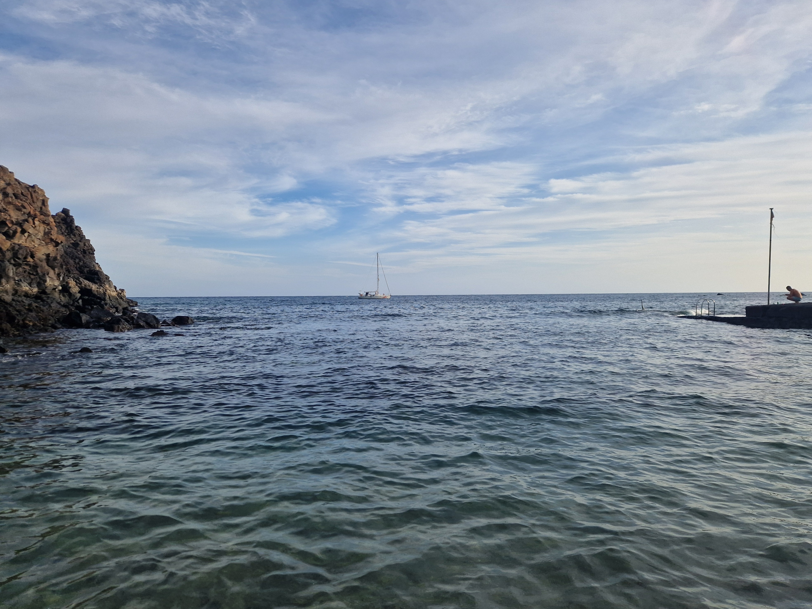
_Meri!_

Uues kohas on isegi poes käik nagu väike seiklus. Esimesest väiksest poest ostsime tee peale jäätist kaasa. Sealne müüja oli võrdlemisi pikka kasvu mees, kes Erkit nähes väga elevile läks ning leti tagant välja pikkusi võrdlema tuli. Erkile jäi veidi alla, aga ütles, et ta on tavaliselt õnnelik, kui ta inimestele otse otsa vaadata saab ning see, et kellelegi alt üles vaadata saab, on täielik imelugu. Hiljem tuli apteekrilt sarnane reaktsioon (leti tagant välja siiski ei tulnud; eks ta oli lühem ka), nii et võib öelda, et Erki tekitas ainuüksi oma kohaloluga kohalikele rõõmu. 

Apteegist sain oma nohu jaoks pseudoefedriini (loe: kohalik Sudafed). Mis mind imestama paneb, on et nii siin kui ka Costa Ricas sain ma sellised tabletid, mida võetakse üks kord päevas, samas kui Eestis olen ainult selliseid kohanud, mida kolm-neli korda võtta tuleb. Igal juhul, ma teen nägu, et need tabletid on aidanud mul nohu kontrolli alla saada. 

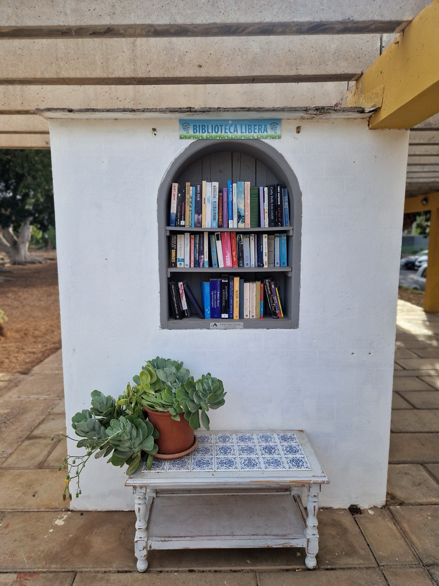
_Pargiraamatukogu - mitmes keeles_

Järgmine kaubanduskogemus oli kohalik Asia Market ehk "hiina pood". Assooridel olime sarnast kohta külastanud, aga siinne näis suurem. Lühidalt öelduna müüakse seal kõike, mida iganes sul vaja minna võib, ning lisaks kõike, mida sa isegi enne ei teadnud, et sul vaja minna võib. Paar vahekäiku olid nagu käsitöölise unistus - värvilised paberid, vildikad, kleepsud, kotid, karbid, sädelev see ja too, igasugused jupstükid. Kui oskaks ette mõelda, siis saaks siit kõik jõulukinkide pakkimiseks tarviliku koju kaasa vedada ning hind oleks pigem Temu sarnane, mitte nagu Pakendikeskuses. Õnneks mul oli konkreetne plaan ainult väike õmbluskomplekt osta ning kui lisa-niit välja arvata, siis pidasin ka plaanist kinni. Ühtegi värviraamatut ega akutrelli ei lisandunud.

Kui me lõpuks dinosauruse pildiga toidupoes käisime, maksime seal nii palju raha, et saime mingi kampaania raames tasuta poekoti ja münditasku. Vaat' siis. Enne veel ütlesime, et ei, kotti pole vaja, sest eks meil olid ju omad vahendid kaasas. Täielik pettumus muidugi, et eile Lidlis mingeid tasuta asju ei jagatud.

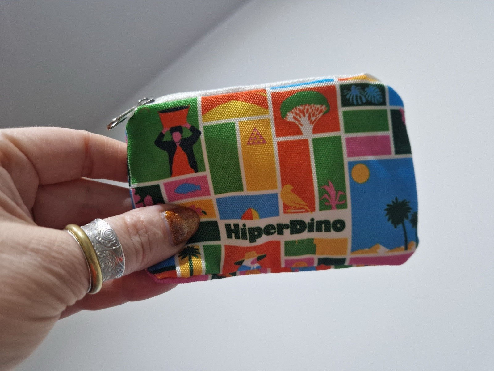{: .small}
_Nänn_

## Neljapäev: argipäev

Pärast seda kui teisipäev ja kolmapäev üheks pikaks päevaks kokku sulandusid, tundus neljapäeva hommikul ärgates, et me oleme siin juba pikalt-pikalt olnud. Tegelikult muidugi oli esimene hommik siinses elamises hambaid pesta ja kohvi teha. Õigupoolest vaatasime esimese asjana hoopis terrassil tähti, kuni liikumisanduriga lamp põlema läks (täna olime targemad ja tulime kohe ülemisele terrassile, kus oli pimedam).

Pärast esimese päeva seiklusi oli neljapäev peaaegu nagu igav. Hommikuseks tähtsündmuseks oli minu kolmandalt korruselt teisele tööle kolimine, sest nohule konditsioneer meeldis, aga mulle nohu ei meeldi.

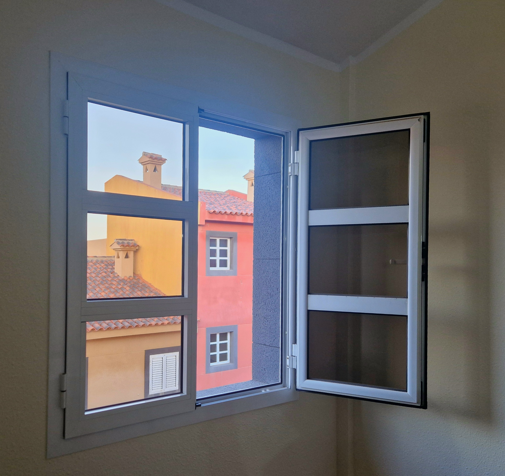
_Laseme sooja sisse..._

Arvestades, et Eestis on praegu öine temperatuur juba nulli ligi ja ega päevalgi priisata pole, on muidugi seda imelik öelda, aga siin on liiga palav. Tänaseks olen natuke juba harjunud, aga eile, st neljapäeval, oli tunne, et lihtsalt seistes higi voolab, käed kleepuvad klaviatuuri külge ja terrassiust pole mõtet lahti teha.

Hiliste koosolekute tõttu sai tööpäev üpris pikk, aga Eesti ajas töötamise pluss on see, et kui kell pool seitse töö lõpetada, siis siin on kell pool viis ja mõni tund valget aega veel ees ootamas. 

Igal juhul, eile peale tööd läksime autoga tutvuma. Kolmapäeva varahommikul vaatasime, et kuidagi kodu üles leiaks ning ei hoolinud eriti ei sinihamba ühendustest ega regenereerivast piduramisest (tegu on pistikhübriidiga). Õigupoolest, mis ma siin ikka mitmust kasutan - Erki sõitis ja mina vahtisin niisama tee ääres laiuvaid imetabaseid tühimikke. 

Käisime Los Christianoses ujumas, rangelt võttes küll mitte Los Christianose rannas vaid Las Vistases. Ujumiseks on seda vast palju nimetada, aga üleni meres ma lõpuks käisin. Lained ei olnud teab mis suured, aga mulle kui tasase veega harjunud eestlasele oli natuke liig. Eriti kui võtta arvesse, et ma läksin ujuma ilma prillideta, mis tähendab, et ega ma hästi ei näinud ka. Või pigem, et kui ma oma lühinägelike silmadega juba lainet nägin, siis pidi see ju väga suur olema... Tore oli sellele vaatamata. 

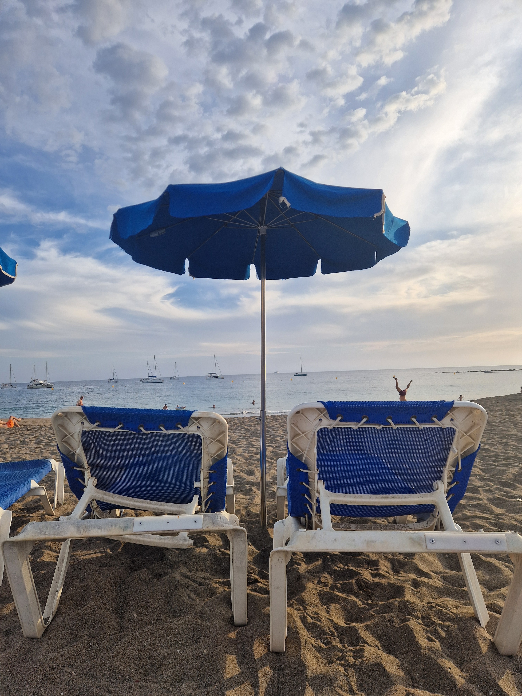
_Kuurort_

Los Christianoses nägime ka esimest kohalikku "metslooma" (sest kassid ei lähe arvesse) - sisalikku. Oli üsna kodusisalike moodi. Kodustest rääkides - õhtul lendasid taevas pääsukesed ning täna hommikul istus terrassinurgal musträstas. Hakkasin mõtlema, kui paljud neist kodust pärit olla võiks.

Järgnes Lidli külastus, mis võttis uskumatult kaua aega. Esiteks tahtis Lidli äpp uuendamist (sest jah, mul on Lidli äpp, aga ma kasutasin seda viimati tõenäoliselt kuskil juulis). Teiseks tuli poolte asjade silte Google Lensiga tõlkida. Kolmandaks oli lihtsalt uusi ja toredaid asju, mida vahtida. Autotäie kraami me sealt igal juhul ära tõime, mistõttu auto lõpuks ka garaaži sai.

Kuidagi poolenisti juba unemaal olles segasin mingi salati kokku, sel ajal kui Erki kotlette küpsetas. Ja õunu pestes mõtlesin, et keegi oli selgelt tühja kõhuga puuvilju ostmas käinud...

Eelnevalt mainitud teeäärsetest tühimikest. Kuna ma ei lugenud enne siia tulemist Tenerife kohta peaaegu mitte midagi ning mingil imelikul põhjusel ei ole iga lohu ja mühu juures turistide jaoks silti, siis guugeldasin enne magama jäämist midagi stiilis "miks on Costa del Silencio lähedal teede ääres nii palju lõigatud servadega vanade kaevanduste moodi platse". Tuleb välja, et mõned eelajaloolisemad võivadki kaevandused olla, aga siin teede vahel on tõenäolisemalt tegu pooleli jäänud kinnisvaraarendustega. Miks sellised augud? Sest kuhugi pidid ju keldrid ka tulema. Eks raha sai otsa ja nii ta siis jäi - nüüd on need "keldrid" nähtavasti kaktuste ja muude taimede kodud.

# 17. oktoober 2026, laupäev
_Samas kohas_

## Reede: retk kohalikule künkale

Reede möödus laias laastus nagu iga teine tavaline tööpäev. Kohalikku elu kuulsin ja nägin nii paljukest, et vahepeal panin akna kinni, et naabrite müristamine ei segaks. Erilist tähelepanu ma nende tegevusele ei pööranud, aga õhtul selgus, et ülejärgmnise naabri aiast oli suur puu kadunud ning meil vaade kohe teine. Ülemisel terrassil mõtlikult kaugusse vaadates võib kõrvaltvaatajaile nüüd mulje jääda, et vahin naabermaja basseini äärset tegevust. Õnneks ma ei mõtle (haa-haa) ega vaata kaugusse (see osa on tõsi) liialt tihti.

Samal ajal kui mina üle tee asuva kõrbega tutvumise peale mõtlesin (mitte kaugusse vaadates), oli Erki genereerinud kohaliku künka otsa ronimise plaani. Hakkan taipama, miks ma tavaliselt ise kõik ära planeerin, et talle üldse mitte võimalustki anda - erinevalt künkast oleks kõrb üsna ühetasane olnud. Et tänapäeva infoküllusest viimast võtta, uurisin enne minekut rajaplaani AllTrailsist (internet soovitas), Mapyst (vennad soovitasid) ja muidugi Google kaardilt (lihtsalt vana harjumus). Nii kui avastasin, et AllTrails ja Mapy täiesti erinevaid valikuid pakuvad, hakkasin hoopis guugeldama, kust nad oma andmeid saavad ning millest selline ebakõla. Lõpuks olin sunnitud siiski õue minema.

Kohaliku künka ehk Monta&ntilde;a Amarilla ümber on õigupoolest paras radadevõrgustik. Enim reklaamitud alguspunkt näis olevat rannas, niisiis suundusime sinna. Erinevalt paari päeva tagusest muljest, et ujuma minekuks tuleb tunniajane jalutuskäik ette võtta, on siinne rand meie elukohast paari tänavavahe kaugusel. Rand tähendab meie külas umbes kahekümne meetri kõrgust kallast, mitte veepiiri. "Ranna" juures saavad kokku eri vanuses pinnavormid - ujumisala on äratuntavalt tardunud laavast koosnev must kivilahmakas, samas kui kõrval asuv küngas oma siiruviirulise jalamiga on pruun mis pruun. Või noh... nime järgi siiski kollane.

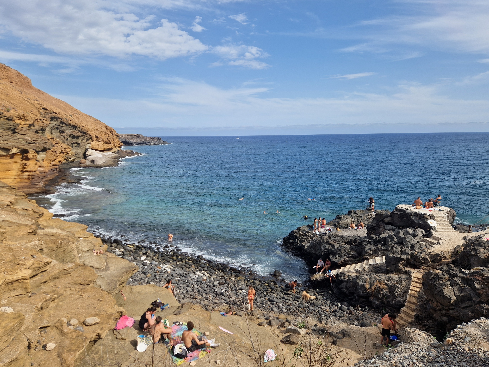
_Meie küla rand_

Pealiskaudsel vaatlusel on Monta&ntilde;a Amarilla näol tegemist tavalise kõrbekünkaga (kui selline asi olemas on...), aga õnneks on lained tema sisemise ilu nähtavale toonud. Mere poolses küljes on paljandunud imeilusad siiru-viirulised kivimikihid, mida inimesed hordide kaupa pildistamas käivad. Internet ütleb, et niisugused kihid tekkisid veealusel vulkaanipurskel laava järsu jahtumise tõttu, kui too mereveega kohtus.

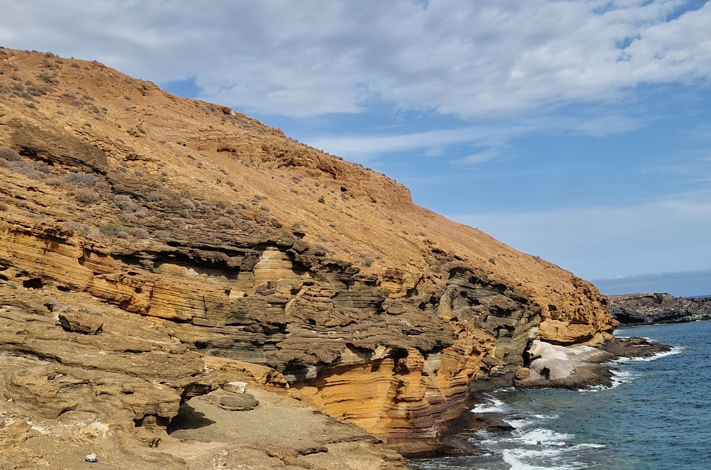
_Siirud-viirud_

Künka otsa viis ilus rada. Kuni enam ei viinud. Korra tundus, et ei saa me ei edasi ega tagasi, kuni selgus, et olime õigest teeotsast mööda pannud. Siin-seal näis, et inimene on looduse loodud trepiastmetele hoogu juurde andnud, et meil lihtsam oleks. Üles ronisime peaaegu viisteist minutit. Pole justkui midagi, aga taaskord sai selgeks, et ei Erki ega minu kere ei ole niisuguse asjaga harjunud, et lisaks sammu pikkusele ka sammu kõrgus loeb. Juba pidasime plaani, et kui künkatagust lauskmaad uudistama läheme, siis rahumeeli ringiga ümber igasuguste pinnavormide. Kaardi pealt vaatasime, et tegemist on vaid umbes kuuekümne meetri kõrguse mühuga, aga poole nõlva peal selja taha vaadates tundus kohalik kodu küll väga kaugel olevat.

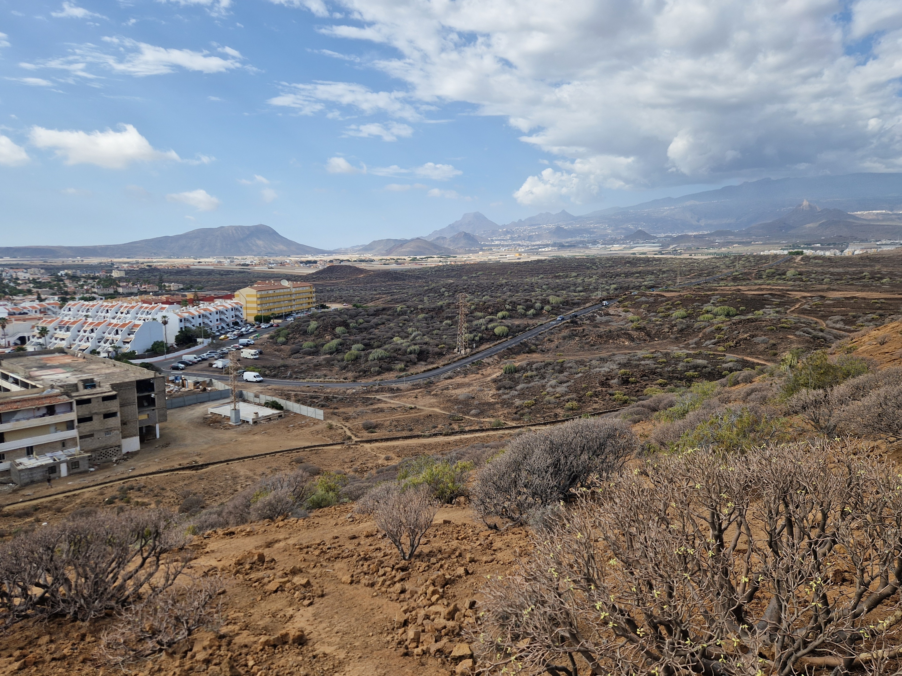
_Pilk selja taha, kodu poole_

Eks neid vulkaanilist päritolu maastikke on nüüdseks juba mõned korrad nähtud, aga igaüks neist on ikka isemoodi. Nagu juba mere ääres näha oli, moodustub Monta&ntilde;a Amarilla laavakihtidest (kirjanduslik lihtsustus). Tipus jätsid need samad kihid mulje justkui oleksime hiiglasliku vöölase seljas. Hulkusime natuke künka harja pidi, nautisime vaateid, laskusime sujuvalt allapoole ning olime pettunud, et õhtuselt madal päike ikka veel kangekaelselt lagipähe paistis.

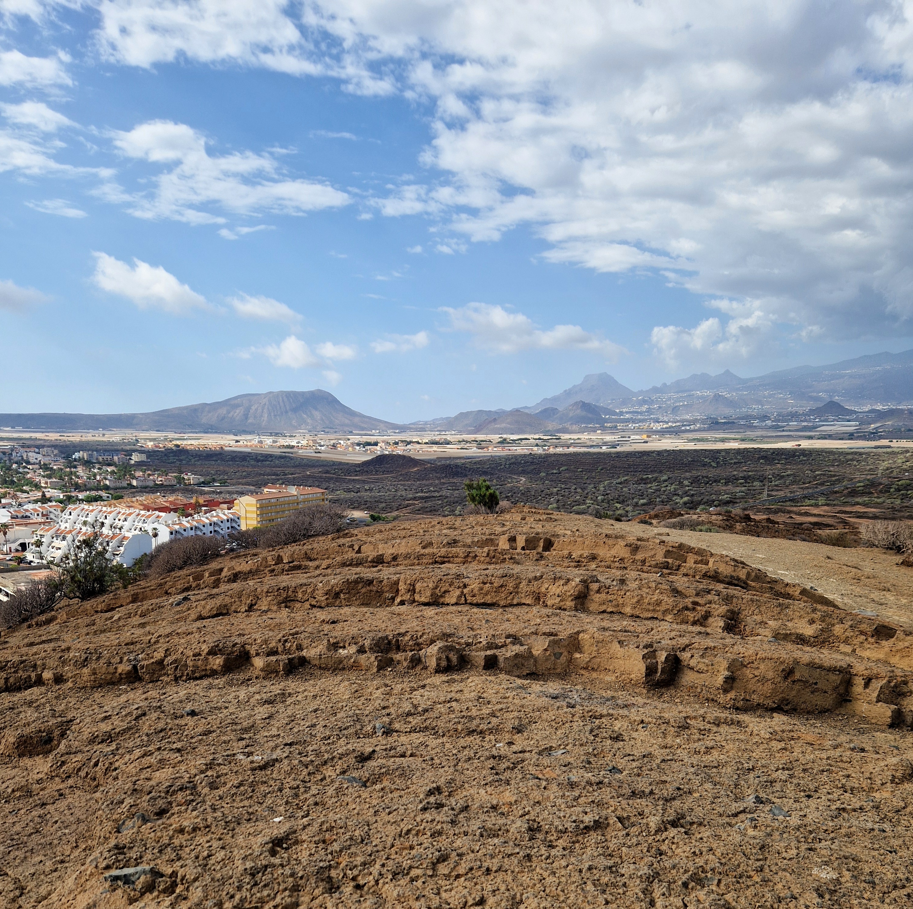
_Vöölase selg_

Monta&ntilde;a Amarilla oma ümbrusega on väike looduskaitseala, mis on madala kiviaiaga ümbritsetud. Aiaäärset rada pidi retke alguspunkti poole tagasi suundudes leidsime end peagi enamvähem omaenda tänavanurgalt ning lugesime reedeõhtuse jalutuskäigu lõpetatuks. 

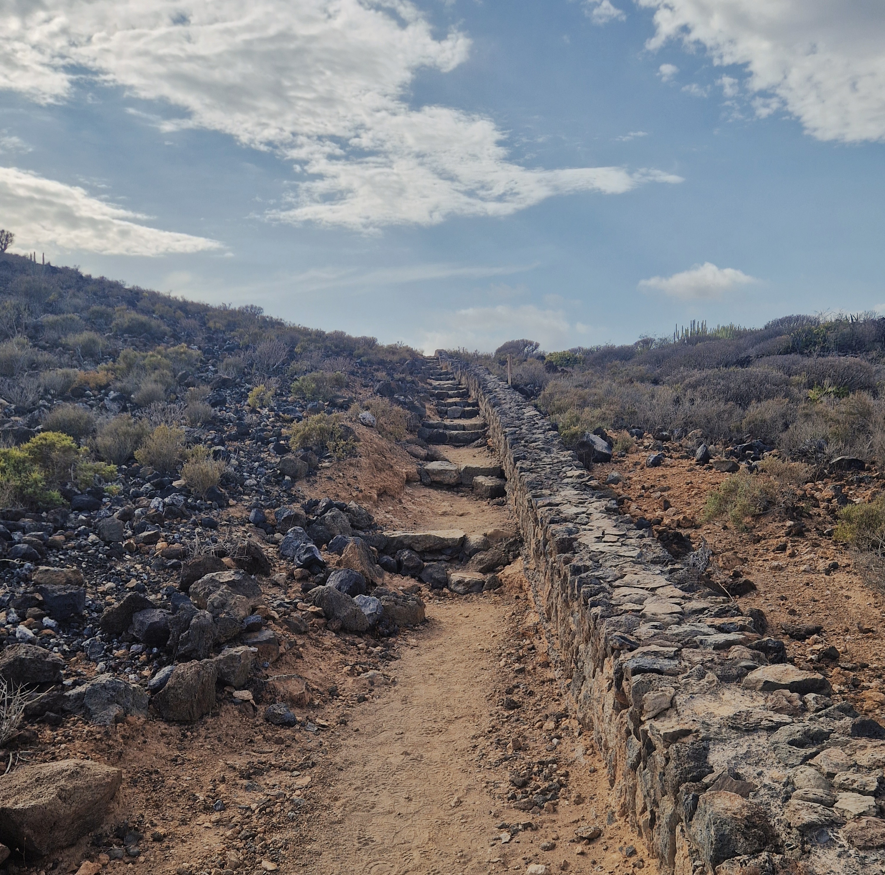
_Meil aiaäärne tänavas..._

Õhtul võtsin ette majast leitud "Minu Tenerife" lugemise. Autor, Olavi Antons, kirjutab oma aastatetagustest seiklustest enamvähem naaberkülas,nii et igati asjakohane materjal. Reeglina ei sünni otsused ühest põhjusest vaid nende summast, aga raamatust koorub välja suur soojuse- ja päikeseigatsus, mida Tenerife imehästi leevendas. Jajah, aga õhtul tuli mul ikkagi sokid ja pusa välja otsida, sest õues oli raudselt alla kahekümneviie kraadi sooja.

## Laupäev: lebo

Laupäeval magasime peaaegu lõunani (loe: üheksani), nii et ärgates oli õues juba valge ja puha. Algas lõunamaareisi passiivpuhkuse osa - vahtisin terrassil kohvi juues mööduvaid lennukeid, mis hommikupäikeses kõiki oma värve demonstreerisid. Õige pea ilmus ei-tea-kust mingi rahutus, võtsime jalad kõhu alt välja ja asusime Las Galletase poole teele. Plaan oli igati hea: jalutame randa, ujume ning selleks ajaks on mõni kalaresto uksed avanud ja saame kõhud täis vitsutada.

Seekord jalutasime mööda mereäärset rada, mis algas "metsaraja" tüüpi teekesega üle musta kivikamara ning jätkus korraliku kõnniteena. Kõnnitee äärsest müürist üle kiigates imetlesime musti kivistunud laavakänkaraid, mille juures lained vett üles pritsisid. Nähes mitmel pool kivide peal võrdlemisi suuri veeloike, hakkasime kohaliku tõusu ja mõõna kohta uurima. Näib, et tõusu- ja mõõnaaegse veeseisu vahe on ainult umbes meeter. Ega lõpuni sotti ei saanudki, kas basseinikesed on pigem tõusust või lainetest tingitud. Jalutasime nimelt mõõna ajal, nii et oma silmaga kah hinnata ei saanud. Aegajalt olid kivimürakate vahel kalamehed või päevitajad. Ja kui ma ütlen "kivimürakad", siis eestlase vaatest on need ikka üsna kaljude moodi. Tekkis küsimus, kuidas inimesed sinna said ja üleüldse, kuidas nad sinna ronida julgesid. Aga äkki ongi nii nagu meie omal ajal ronisime ja kolasime omal maal, nii nemad on elu aeg roninud ja kolanud nende laavamürakate keskel ning see ei olegi probleem... 

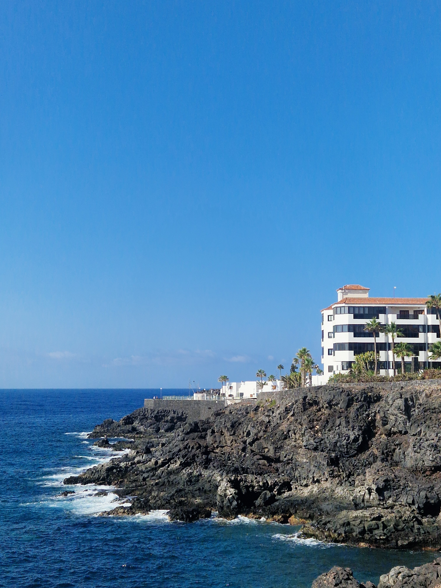
_Mustadest laavakänkaratest rannik_

_**Jätkub...**_

# 18. oktoober 2026, pühapäev
_Ikka siin_

## Laupäev: jalutuskäik randa

Õigupoolest väsisin ma eile õhtul kirjutamisest ära ning nii see laupäeva lugu pooleli jäigi. Lühidalt öelduna logisime põhimõtte pärast ühe lihtsama geopeituse aarde ära; saime liiga palju päikest; Erki tegi vea ja lasi mu üksi ajakirjade/kirjatarvete kioskisse; unustasime, et me ei ole viiesed ning sõime lõunaks kala asemel poest ostetud saia ja krõpse. Mitu tundi hiljem saabusid väsinud turistid koju ja viskasid sirakile.

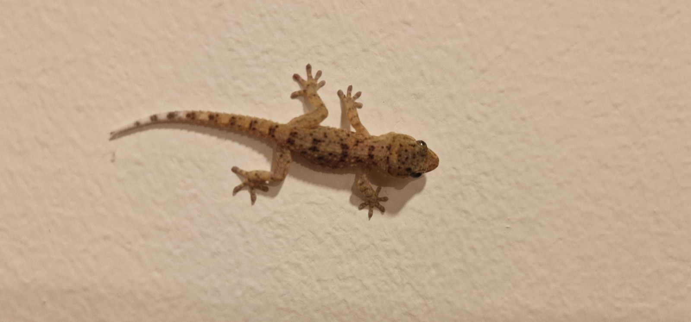{: .small}
_Külaline_

Aga kõige tähtsam - me leidsime lõpuks laineteta ranna, kus sai päriselt ujuda! Las Galletase sadamas. Ma ei ole päris kindel, kui tervislik jahtidele nii lähedal asuvas vees sulistamine on, aga ega eriti ei hooli ka. Natukeseks oli tunne, et ma ei tulegi sealt enam välja ja maetagu mind koos selle merega.

Mõnevõrra imeks pandav on siinne riietumiskultuur. Kuuldavasti on mõndades randades ka riietumiseks ette nähtud kabiinikesed, aga neis, kuhu me seni sattunud oleme, on isegi tualettruumid kinni olnud, muudest putkadest rääkimata. Orienteerujana olen ma muidugi harjunud suvakas kohas riideid vahetama, aga arvasin, et see on mingi Eesti järve- ja metsakultuuri osa ning siinsed inimesed (loe: turistid) on pepsimad. Näib, et mitte.

## Pühapäev: uus lebo-katse ja rattasõit

Kuna eile kuumenesime veits üle, otsustasime täna kodus konutada ja tõsiselt passiivpuhkusele rõhuda.

Mõnda aega see isegi töötas, kuni ma läksin keldrisse jalgrattaid uurima. Kui uurima juba läksin, eks ma siis pumpasin kummid ka täis. Kummid täis, võis ju garaaži juures väikse testsõidu ka teha. Kurja, kui hea ratas! Ega mu kodune Radon ka paha ei ole, aga see siin muutub sõites nagu su enda kehaosaks. Kraamisin rattariided välja, Erki andis mulle kaks veepudelit ka kaasa ja minek!

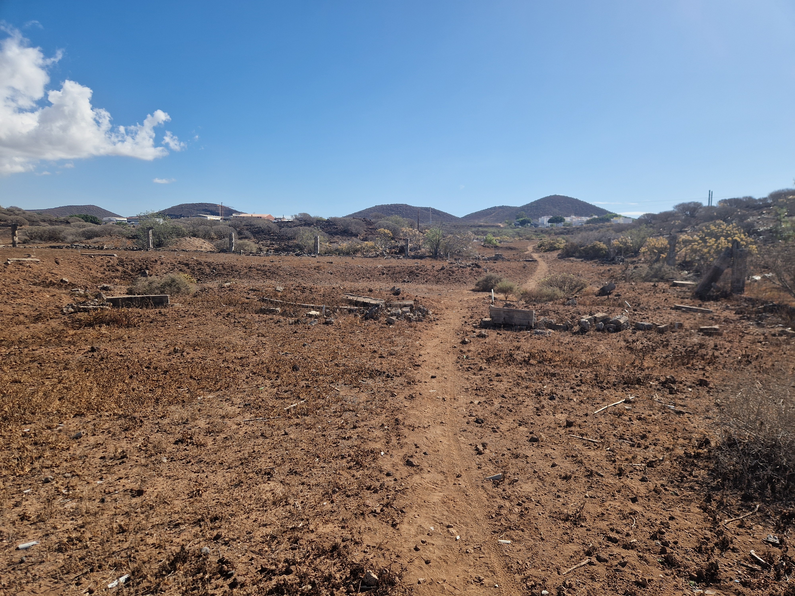
_Kõrbes leidub lisaks kaktustele igasugust inimtekkelist kola_

Esimesed paar minutit sõitsin asfalti mööda, siis suundusin kohalikku kõrbesse. Eks ma pabistasin ka - suured kivid, võõras maastik, lõõskav päike. Tegelikult õnnestus mul väiksemate radade vahelt paar täitsa laia "kruusateed" ka leida ning, kui maastikust rääkida, siis ei pea ju künka otsa sõitma, kui ei taha. Päikese osas ei olnud paraku midagi teha, nii et vähem kui tunni pärast olin kõpsti kodus tagasi, plaaniga homme kas varasemal või hilisemal kellaajal käiku korrata. Sest see oli lihtsalt nii lõbus!

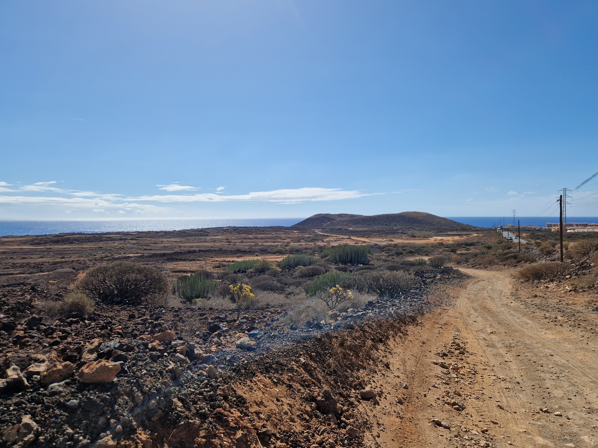
_Kodutee_

Edasi rõhun nüüd jälle lebotamisele.

# 21. oktoober 2026, kolmapäev
_Vaikuse rannikul, kus on täna tuulisevõitu_

## Esmaspäev: vihm

Esmaspäevane tähtsündmus oli vihmasadu.

Ootasime juba mitu õhtut, sest ilmateade lubas uut ja vana, Teide oli kogu aeg pilvedesse peitunud ning aegajalt hiilisid mere kohal ka tumesinised pilvelaamad. Piisab üle tänava loodusesse vaatamisest, et meelde tuletada, et me asume kõrbes ning igasugune jutt vihmast on mõne paariaasta taguse tormi legend või vanainimeste heietus, kuidas vanasti oli Teide kõrgem ja Lõuna-Tenerife jõed laiemad. See meid ei heidutanud - lootus surevat ju viimasena.

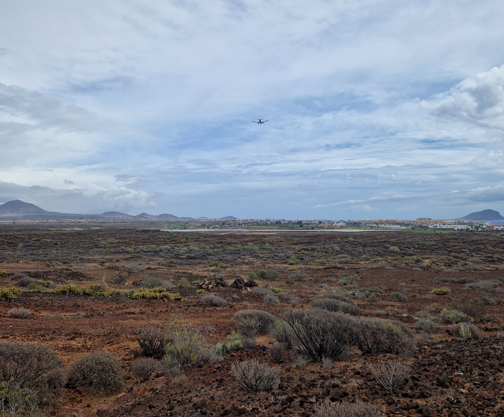
_Ikka veel kõrb_

Igal juhul oli minul juba lõunapaus planeeritud ja rattariidedki seljas, kui selgus, et terrassil on kivid märjad. Ning tõesti-tõesti, õue astudes selgus, et _midagi märga_ taevast alla sajab ka. Kodus ei kutsuks me seda veel isegi seenevihmaks ja läbi vettimiseks peaks selle all vist nädalaid seisma. Aga siin ikka ootasin pool tunnikest, enne sõitma minekut, sest noh... maitea... äkki on kivid libedad või midagi.

## Teisipäev: märkmeid elust

#### Naabrilastel on uskumatus koguses palle
Nii suured kui ka väiksed mängivad aias jalkat, mis tähendab, et aegajalt lendab mõni pall ka meie aeda. Eks me viskame tagasi. Aga enne meie saabumist oli siinne pererahvas mõnda aega ära olnud, nii et keegi polnud palle üle aia tagasi loopinud. Niisiis leidsime me eest üle kümne palli ja tõdesime, et olukord oli ilmselt juba päris hull, sest jalgpallina olid kasutusele võetud nii kummist, kangast kui ka švammist pallid.

#### Linnud on teised, aga samas ka justkui samad
Võtame näiteks tuvid. Näed mõnda, siis saad ilmselgelt aru, et tegu on tuviga. Kuju on tuvi oma, hääl samuti, aga värv on kuidagi kahvatu ja kõhnakesed on nad ka. Seni oleme näinud üht "tavasuuruses" tuvi. Too kõhutas mere ääres kivinuki peal ja vaatas ookeani. Meretuvi?

Musträstas, ei teagi, kas üks või mitu. Hüpleb aegajalt maja läheduses ringi - mõtlen, et kas ta võib mõni meie kodune olla, kes siia talvituma lennanud on.

Sama lugu pääsukestega (vabandust, kui nad tegelikult piiritajad on) - kas nad on statsionaarsed või peaks neile "tere" ütlema, sest on samad, kes kodus naabrite räästas pesitsevad?

Või kõnnime poest koju ja kuuleme, et palmide otsast kostab tuttav "silk-solk", nagu kevadisel Eestimaal. Tore linnu-äpp Merlin ütles, et tegu oligi lehelinnuga, kes meilgi sama häält teeb. Ainult, et kanaari lehelinnuga, kes on välimuselt absoluutselt teistsugune kui meie väike lehelind (mitte, et neid kumbagi oleks võimalik kuidagi lehestikust eristada ja ma neid kunagi näinud oleks).

Aga rohelisi kaeluspapagoisid ma kutsun kohalikeks hakkideks, sest nad räuskavad igal pool ning nende tõttu on datlipalmide alused liga-löga täis. Nad nimelt käivad nonde otsas söömas, mille käigus nii kive kui ka poolikuid datleid muudkui pudeneb.

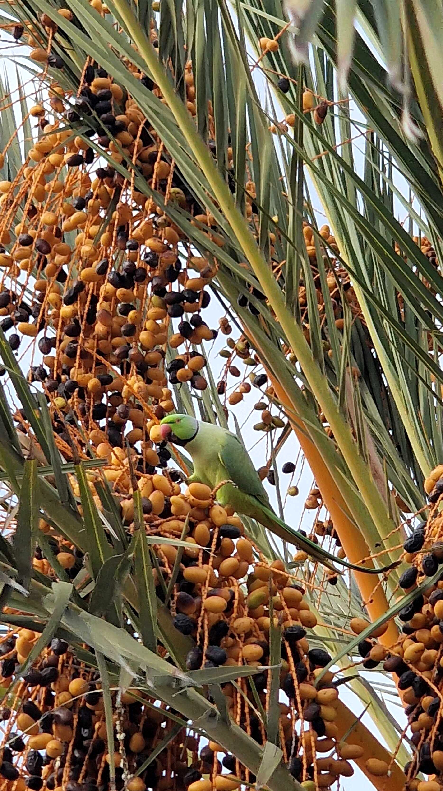
_Datliõgard omas elemendis_

#### Poes käik on endiselt seiklus
Kes oleks võinud arvata, et Coca-Cola pudelitest torni otsas olev punane Coca-Cola kirjaga silt on tegelikult lihaleti järjekorranumbrite väljastamise aparaat.

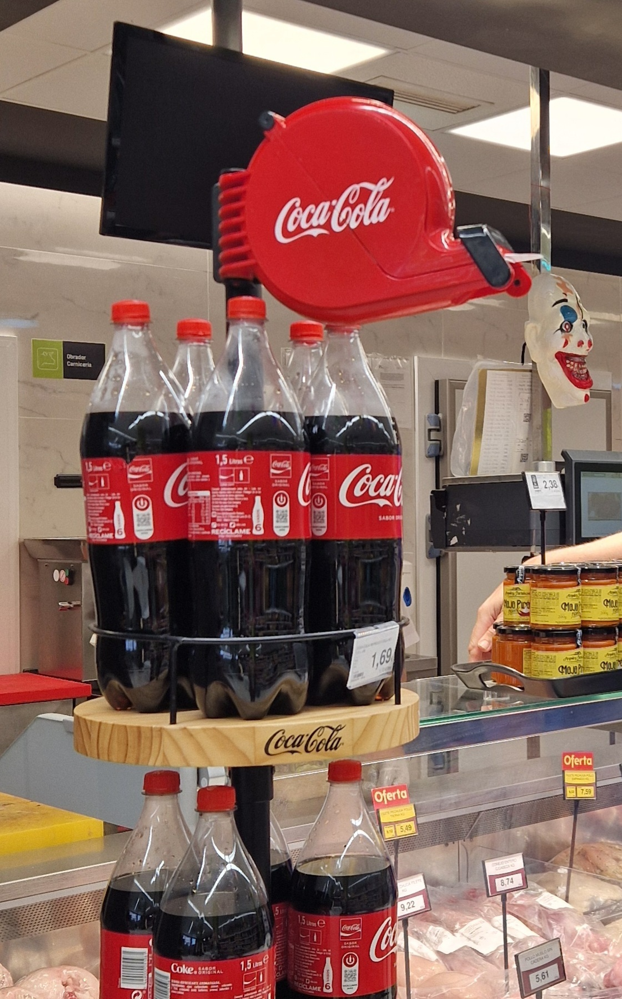{: .small}
_Coca-Cola kui lihaleti sponsor_

#### Inimene harjub kõigega, eriti heade asjadega
Isegi palavusega. Võib lausa nii ära harjuda, et kui ühel hommikul õues ainult 24 kraadi sooja oli, siis jõin kohvi terrassi asemel toas.

## Kolmapäev: lõpuks puhkus

Täna oli puhkuse esimene päev. Kohati tundub, nagu oleksime siin juba pikalt olnud, aga ringi sõitnud ei olegi. Tuletan endale siis vahepeal meelde, et ega tööpäeval väga kaugele ei sõidagi ja tegelikult ei pea puhkuse ajal ka kogu aeg ringi kupatama, vaid võib päriselt puhata ka.

Meeldivalt pilvise ja tuulise ilma puhul võtsime ette jalutuskäigu vana kaevanduse juurde. Meie lähimal künkal, Monta&ntilde;a Amarillal on tegelikult omas vanuses sõpru ka: Monta&ntilde;ad Malpasito, Negra ja del Majano (erinevatel andmetel veel mõned). Kuna erinevalt Amarillast ei ole teised künkad looduskaitse all, on neid siit-sealt õõnestatud. Eriti Majano näeb õige nurga alt vaadatuna välja, nagu kukuks künka pealmine kuppel kohe-kohe korruse võrra allapoole, sest all on olukord väga hõre.

Internet ütles, et Majano tähendab lihtsalt öelduna põllukividest kuhja. Põldu on selle naabruses tõesti haritud ning kivegi ära korjatud, aga Monta&ntilde;e del Majano on ikkagi vulkaan, mitte tühipaljas kivihunnik. Kogu sõpruskond olevat kuskil mõnesaja tuhande aasta tagune vulkaanide punt, millest igaüks natuke aega purskas ja siis pillid kotti pani. 

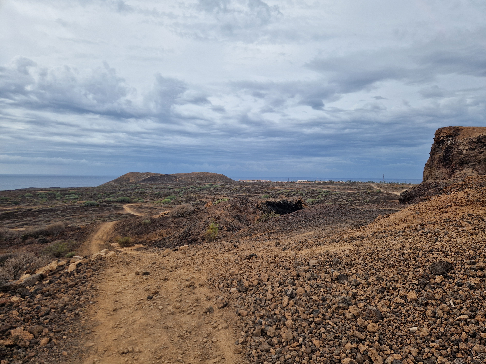
_Vulkaanikesed_

Siinkohal parandan ka eelmisel nädalal tehtud vea - arvasin (nagu paljud teised), et Amarilla juures näha olevad pruunikad ja mustad kivimid on erinevatest ajastutest pärit, aga tõenäoliselt ei olegi. Must kivim pole lihtsalt kuumana vette sattunud ja sealt mineraale kaasa haaranud nagu kollase/pruuniga juhtus.

Pealtnäha on see kõik nagu natuke kuivem Lõuna-Eesti kuppelmaastik, aga erinevateks otstarveteks vulkaanilist kivimit kaevandades on ladestunud kihid ilusti nähtavale toodud. Noh... peamiselt mustad. Sekka mõni heledam viirg või kollane kiht.

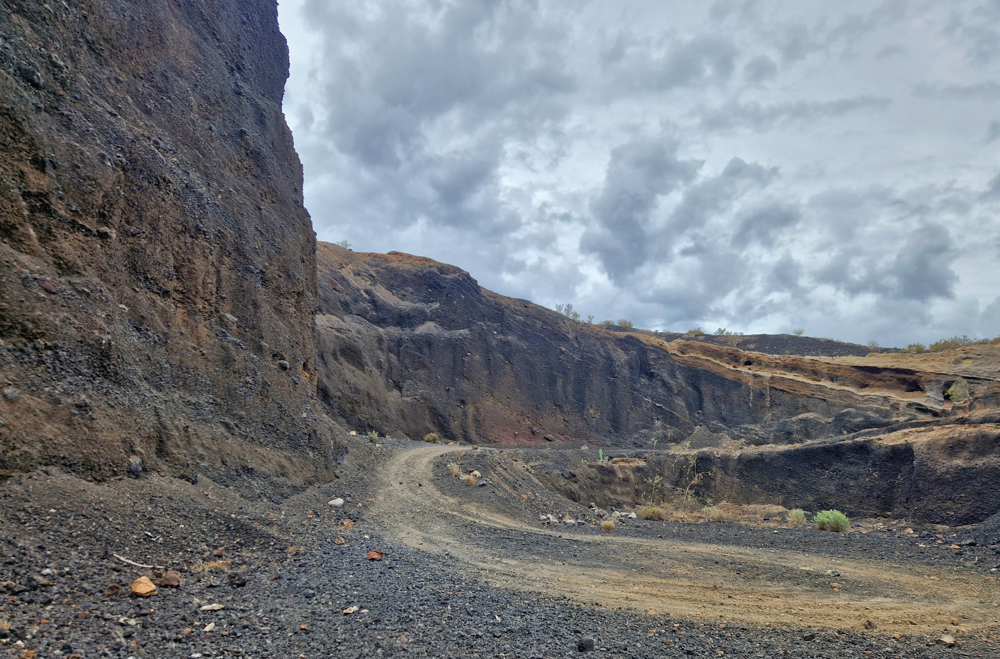
_Üks osa vanast karjäärist_

Kuuldavasti on neist küngastest saadud materjali nii ehituseks, teede rajamiseks kui ka lähedalasuvate põllumaade toitmiseks kasutatud. Ajaloost lugedes leidsin, et Lõuna-Tenerifest sai turismimeka alles möödunud sajandi teises pooles ning enne seda oli siin pigem tomati- ja kartulikasvatuse piirkond.

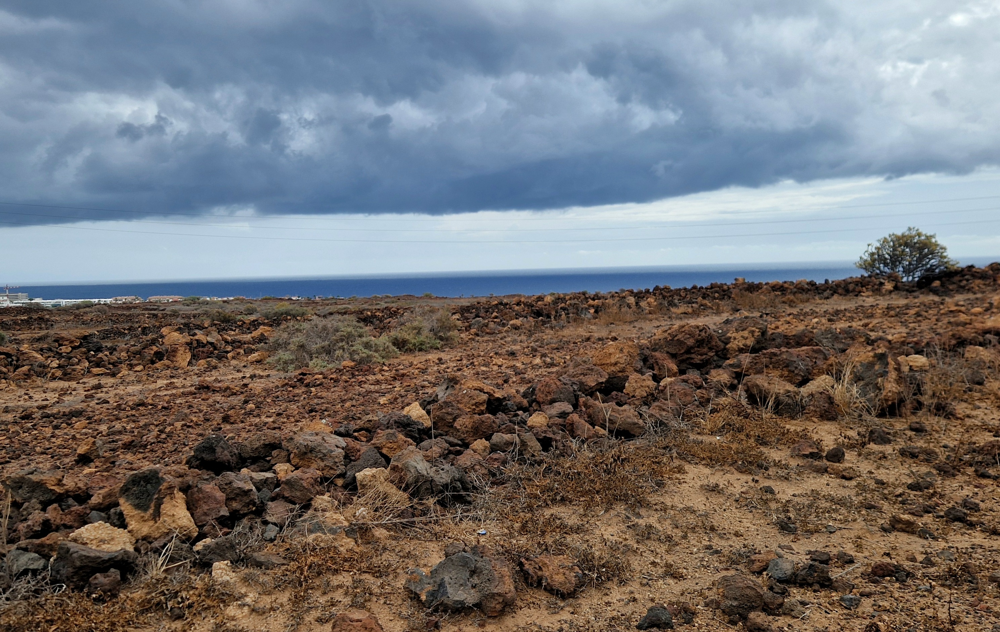
_Kiviaiad põllulappide vahel - põld kividest puhtaks ja taimedele tuulekaitse ka olemas_

Möödunud aegadest annavad märku pikad kiviaedade rivid ning siinseal vedelevad niisutussüsteemide osad. Mäe kaevandamine haakub põllumajandusega suurelt jaolt just niiskuse, õigemini selle puudumise, kaudu. Mäest kaevatud poorne materjal pandi kihina põllumaadele, kus see öösiti tekkivat kastet endasse kogus, et taimedel ka päeval üht-teist võtta oleks. Lisaboonusena sisaldas sama materjal palju erinevaid mineraale, mis pikatoimelise väetisena töötasid. Kummaline on mõelda, et see kõik ei toimunud siin mitte sajand vaid ainult mõnikümmend aastat tagasi.

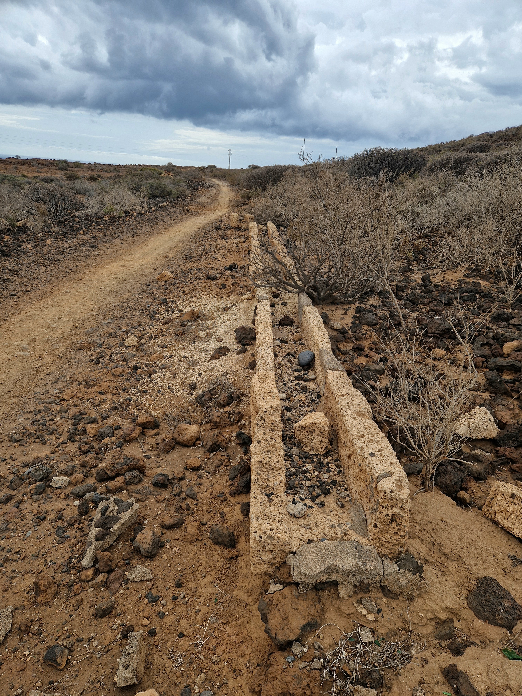
_Üks väheke tervem niisutussüsteemi jupp_

# 24. oktoober 2026, laupäev
_Silencios_

## Neljapäev: Teide ei võtnud külalisi vastu

Hommik algas imekenasti - väravast välja astudes nägin esimese asjana pilvevaba Teidet ning nii me tema poole vurama hakkasime. Väike ohumärk vast oli, et Teide tipp oli kuidagi valge.

Poole tee peal, kui mul pea kummaliselt kumises, tegime väikse hingamis- ja pildistamispeatuse. Seal juhtusin ka telefoni vaatama ning selgus, et igasugused küsimused selles osas, kas me jaksame tippu ka matkata või mitte, lahenesid iseenesest - halva ilma tõttu on köisraudtee (loe: trossi otsas kõlkuv kabiin) suletud.

Eks see oht oli alati teada olnud, aga natuke kurb on ikka. Uue aja saamise nimel oma saarel olemise aega vast pikendama ka ei hakka. Järelikult tuleb tagasi tulla!

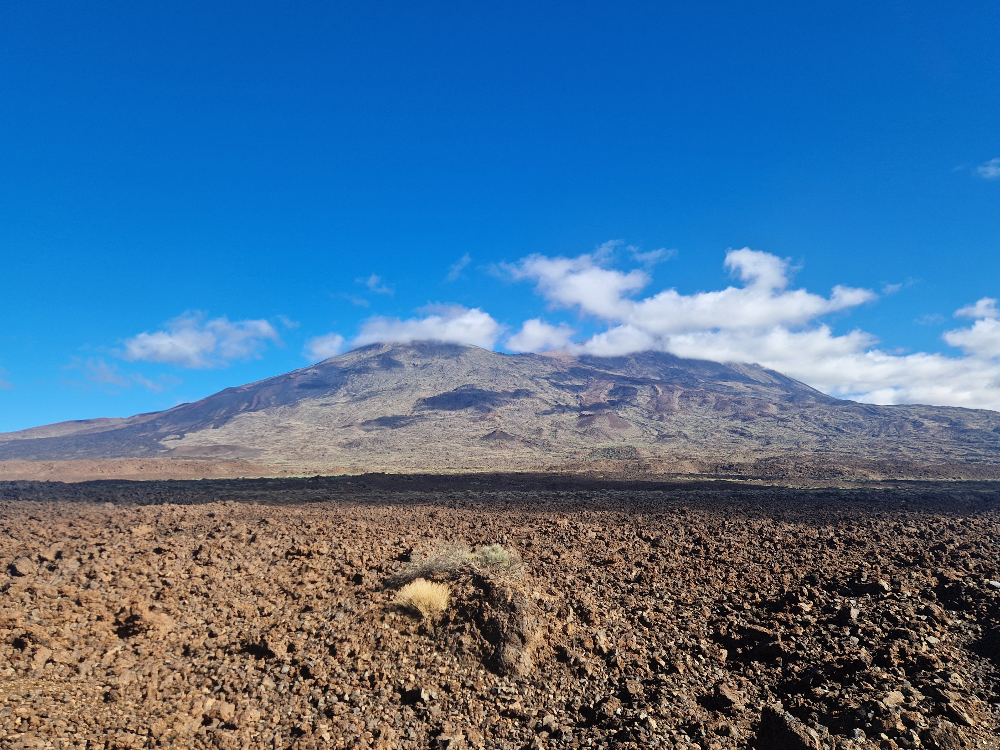
_Teide on see parempoolne, kes end pilves peidab_

Otsustasime hoopis mägiteedest ja looduse vaatlemisest viimast võtta. Kuna peatumiskohad olid paksult autosid täis, tegin mõned pildid sõidu pealt aknast. Kahes kohas õnnestus meil siiski ka nina korraks välja pista. Hispaania kõrgeimal asuvaks külaks nimetatud Vilaflori ümbruses on väga ilusad männimetsad. Täna uuesti sealtkandist läbi sõites guugeldasin, et mis see tähendab, et looduskaitseala nimi on Corona Forestal. Selgus, et laias laastus tähendab see "metsast krooni", sest männimetsa ala ulatub vahelduva eduga mõnesaja meetri kõrguselt vaat' et 2700 meetri peale välja ning ümbritseb Teide "pealage" nagu kroon. 

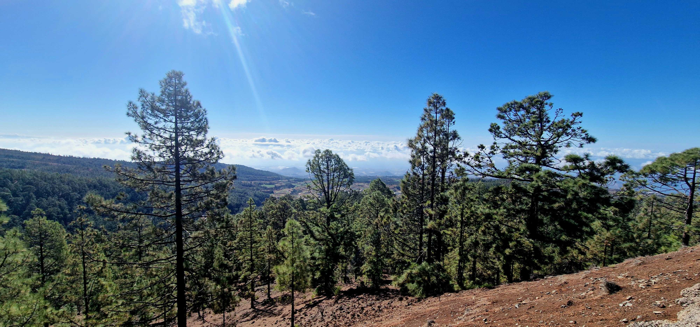
_Vilaflori lähistel pealpool pilvi_

Teises suunas, Los Gigantese poolt Teidele lähenedes, kust me neljapäeval alla sõitsime, on suured laavaväljad. Sarnased neile, mida me poolteist aastat tagasi Lanzarotel nägime. Etteruttavalt mainin, et täna rändasime sealt poolt Teidele ning peatusime värskeima ehk 1909 aastal tekkinud laavavälja servas. Natuke nagu Kalevipoja kartulimaa, vaod veel sisse ajamata.

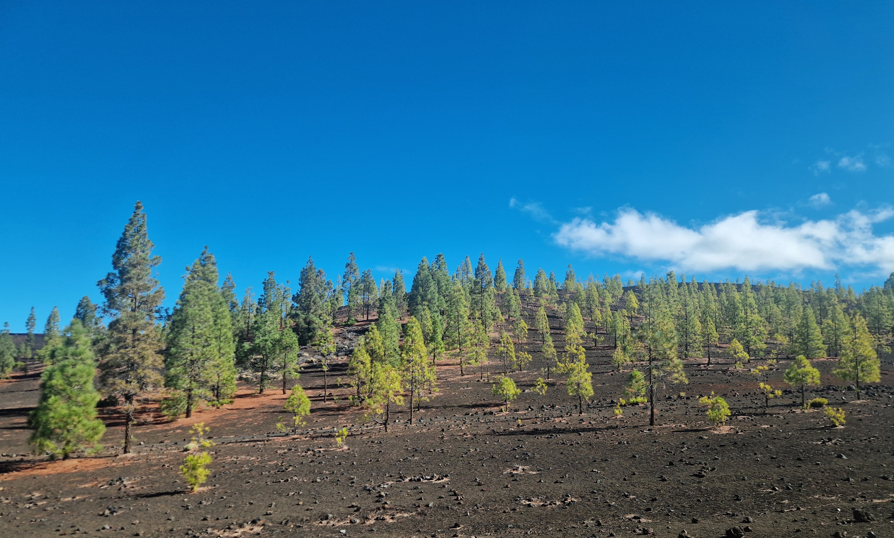
_Ilus männik Kalevipoja kartulimaa naabruses_

Los Gigantese vaatluspunktis me peatuda ei saanud, jällegi autode rohkuse tõttu. Vaatasime siis tee pealt aknast. Väga muljetavaldav... 

Ootan huviga Loode-Tenerife metsamaastiku külastust, arvestades kui erinevad juba Vilaflori männimetsad meie rannaäärsest loodusest olid.

Nojah... kodus pakkisime siis pikad püksid, matkakepid ja vihmajoped ilusti kohvrisse tagasi. On väga vähe tõenäoline, et neid selle reisi jooksul enne Riia lennujaama tarvis läheb.

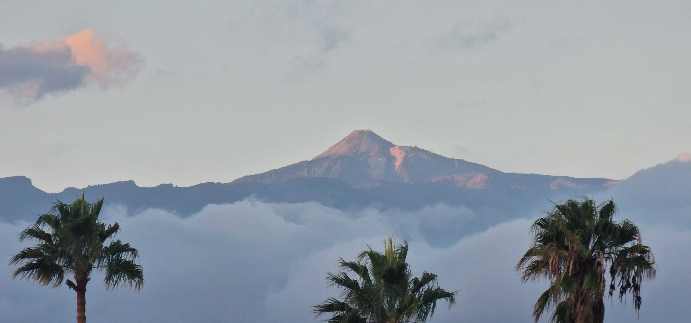
_Teide meid külla ei oodanud, aga õhtul peesitas loojangus küll nagu õige mees kunagi_

Vahemärkus - kõik Tenerife elanikud ja külalised võivad nüüd kindlad olla, et vulkaanidest lähtuva ohu hoiatussüsteem töötab nagu nalja. Neljapäeval nimelt oli teavitussõnumite saatmise test (mõnel pool ka evakuatsiooniõppus) ning nii hommikul kui ka päeval hakkasid meie telefonid korralikult üürgama. Päeval saime kinnitust, et sama juhtus paljude teistega, sest alarm saadeti ajal, mil me poes olime. Juhtumisi oli poes ka teisi inimesi ning teatavasti on enamikel telefon kogu aeg kaasas. Nii läks üle terve poe selline lärm lahti, et ma arvasin esialgu, et mõni maja enda turvasüsteem läks häiresse, enne kui taipasin, et üks neist lärmajatest on mu enda taskus.

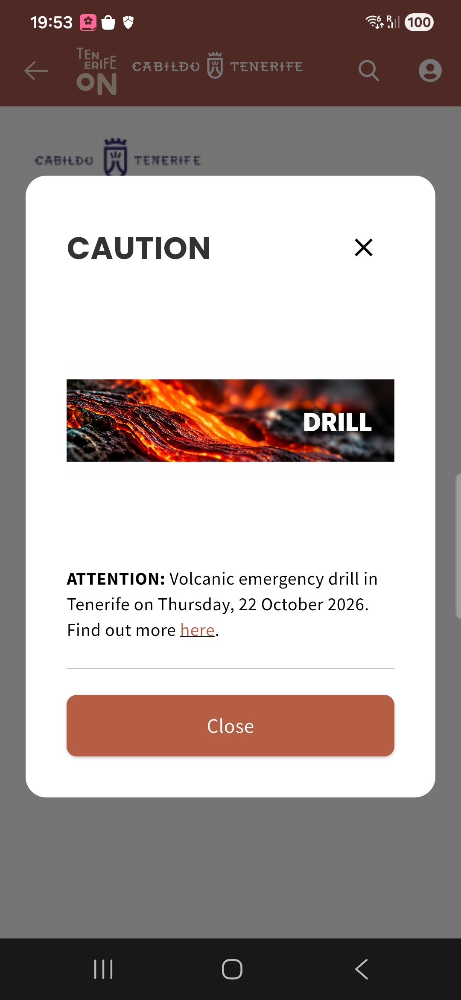{: .small}
_Samal päeval, kui me vulkaanile ei saanud, toimus ka ülesaareline õppus_

## Reede: toetan siinseid väikeettevõtjaid

Reede hommikuks panime äratuskella, et enne palavat keskpäeva Las Galletase turule jõuda. Me ei osanud täpselt oodata ka, mis see va turg endast kujutab. Meie mõistes oli tegu pisikese laadakesega, kus käsitöölised oma kaupa pakkusid. Minu eesmärk mingit liiki kohalikku näputööd koju viia sai kolme paari kõrvarõngaste näol täidetud.

Järgmine päevakorrapunkt oli Finca Canarias Aloe Vera kasvanduse külastus. Kui me kella kaheks sinna ilmusime, olid nad muidugi unustanud, et meil üldse ekskursioon tellitud oli, aga nad võtsid ennast võrdlemisi kiiresti kokku ja tegid asja ära. Saime teada, et aaloed on umbes kolmsada liiki ning päris paljud neist liikidest on mürgised. (Suvakat aaloed enam naljalt käppima minna ei taha...) Nemad kasvatavad oma toodete tegemiseks kollaseõielist sorti, mille nime ma päris kindlasti ei mäleta. Lehti saab korjama hakata 3-5 aastastelt taimedelt ning kuni umbes 40 aastani välja. Oli täitsa huvitav ja lõpuks jätsin neile märkimisväärse osa oma palgast, sest kui juba kohaliku aaloe kasvandusse minna, tuleb kõigile kodustele sealt 98-protsendilist geeli ka kaasa tuua. 

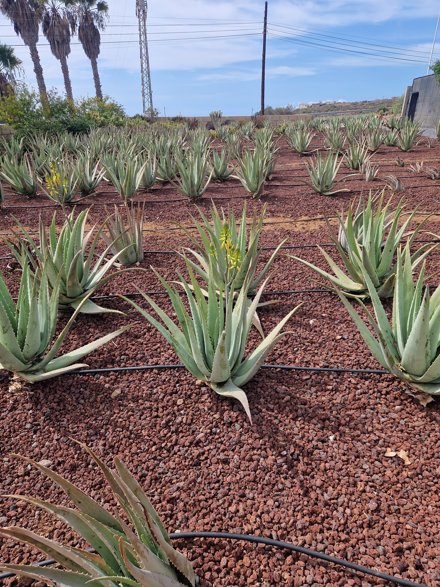
_Arona aaloed_

Täna õppisime lisaks, et agaav, mida siin ka võrdlemisi tihedalt kasvab ja mis näeb välja nagu üleelusuuruses aaloe, ei ole temaga üldse mitte suguluses.

## Laupäev: väljasõit rohelusse

Mõned päevad tagasi tekkis mul loorberimetsas käimise kinnisidee. Vanimad ja kauneimad pidavat saare kirdeosas asuma. Kuna me otsutasime, et too nurk jääb seekord külastamata, hakkasin uurima, kus sarnast kraami veel kasvab. Loode-Tenerifel asuv Teno rahvuspark aitas hädast välja. Pärast mõningast arutelu võtsime suuna Erjose küla poole.

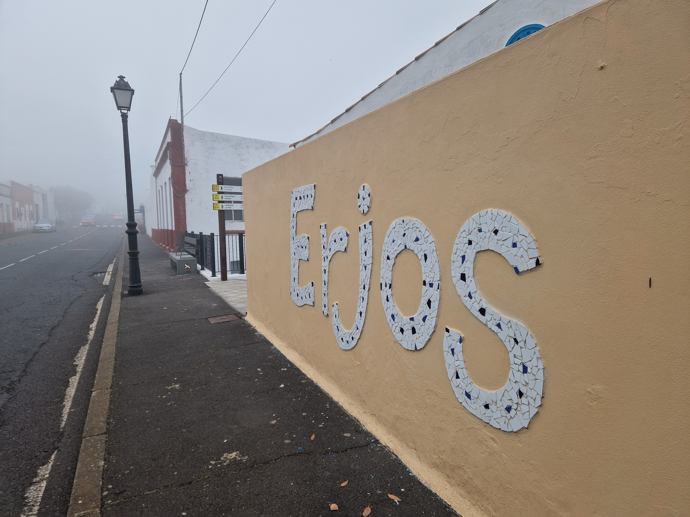
_Erjose küla pilve mässituna_

Küla osutus vaikseks pilve sees tukkuvaks kohakeseks. Nägime kohalike inimeste elamisi, aialappe, kaktuse viljade korjamist ning isegi üht kana. Müstiline, kuidas ühele saarele nii erinevad paigad mahuvad; eriti arvestades, et me ei ole päris põhjarannikule veel jõudnudki. Costa del Silencios vaevu kasvab midagi ning huvilised võivad hommikust õhtuni päikest võtta, samas kui Erjoses tervitas meid udu (loe: pilv, mis siin-seal üle tee ujus), lopsakas taimestik ning mõnus alla kahekümnekraadine temperatuur.

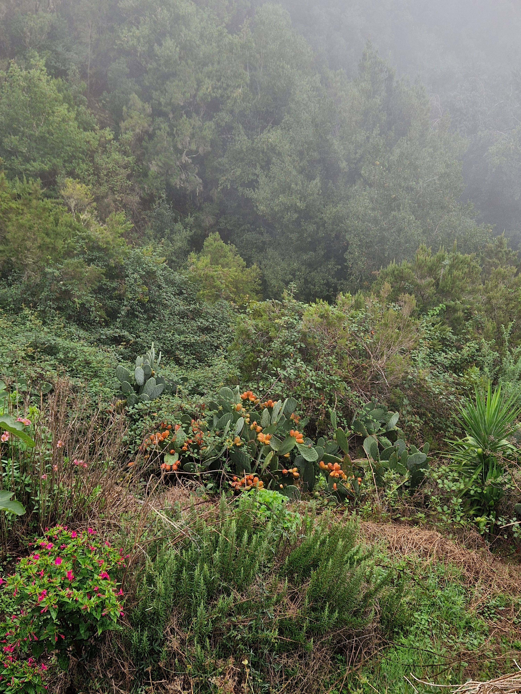
_Üks kohalikest aedadest_

Matkaradadega näib siinmail nii olevat, et on igasuguseid äppe, neist kõige enam soovitatud TenerifeON. Lisaks on meil Erkiga kahepeale kolm-neli kaardirakendust, nii _online_ kui ka _offline_. Ja lõpuks kukkus ikkagi nii välja, et leidsime Erjose küla servast metsa poole mineva raja kohalike siltide ja Gemini koostöös.

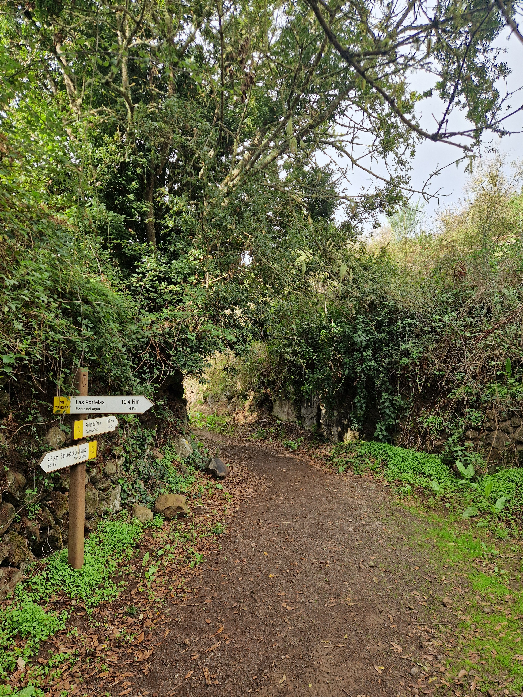
_Rajad on äppide erimeelsustele vaatamata vähemalt maastikul hästi tähistatud_

Alustasime Erjose keskelt. Matkaradu näis jaguvat. Samas ei olnud nad kõik tingimata samade nimede ja pikkustega, mida äpis lubati. 

Esimeseks valisime Cuevas Negras. Olgu ka öeldud, et enne kui ma loorberimetsa jutuga lagedale tulin, plaanisime me kohalikke järvi vaatama minna. Sest järved. Tenerifel.
Rada oli selles mõttes tore, et viis meid kahtlemata rohelusse - möödusime mõningatest aedadest ning kivine rada jätkus meie mõistes võsa vahel. Ümberringi märg pilv. Kuna meil päris kindlat plaani selle rajaga polnud ning järvedeni see ilmselgelt ei viinud, siis otsustasime kuskilt maalt, et on seda libedat kivi pidi kuhugi orgu juba astutud kah, pöörame otsa ringi ja proovime midagi muud.

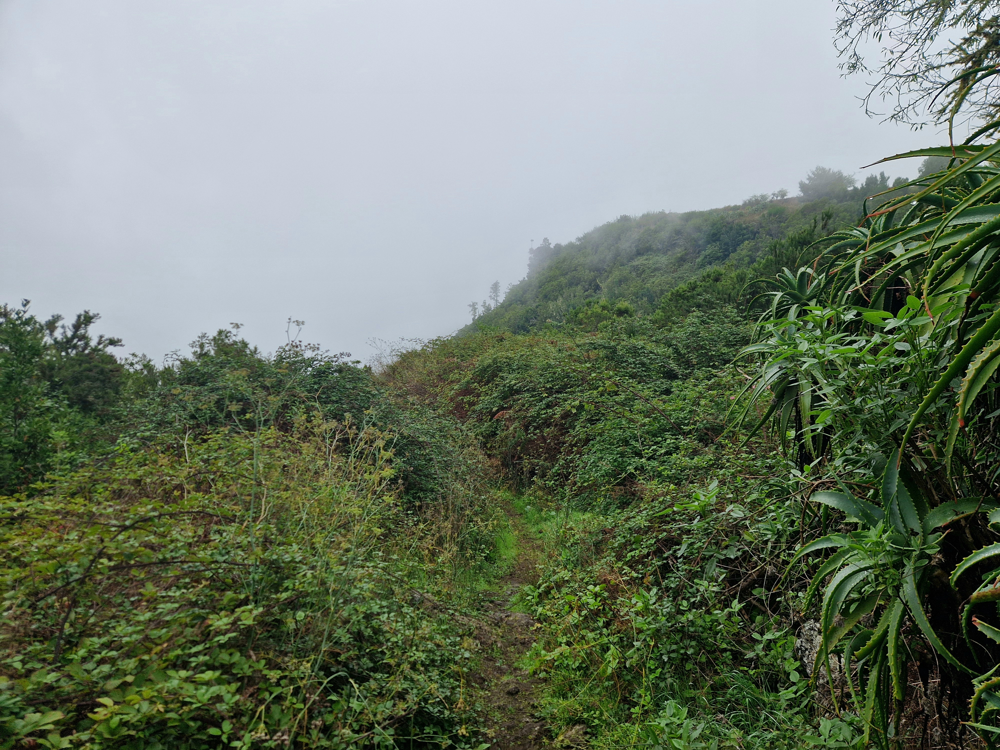
_Tee mustade koobaste juurde, nähtavuse asemel piimasupivaade_

Järgmine valik oli küla servast majade vahelt Las Portelase poole lõiku panna. Peagi leidsime end ristteelt. Väike erinevate äppidega sahmerdamine tegi selgeks, kus pool järvekesed asuvad ning jalutuskäik jätkus. Pikemas plaanis läks rada Punta del Teno poole ning tegu oli päris korraliku teega - sellisega, kus mahub kõrvuti käima ning saab vahepeal lisaks jalge ette vaatamisele ka ringi vahtida. Samuti oli teekond valdavalt varjus - kas siis pilve või võsa või mõlema tõttu. Päris mõnus vaheldus lauspäikeses rannikule. Vastu tuli nii käimiskeppidega matkajaid kui ka koertega jalutajaid. Kogu kogemus oli võibolla isegi liiga tsiviliseeritud. Põhiliselt tekitasid elevust tee ääres krabistavad sisalikud ning üllatavalt suured ja lõhnavad tillipuhmad. Samas - on seda elevust siis kogu aeg vaja, puhkus ikkagi, võta rahulikult.

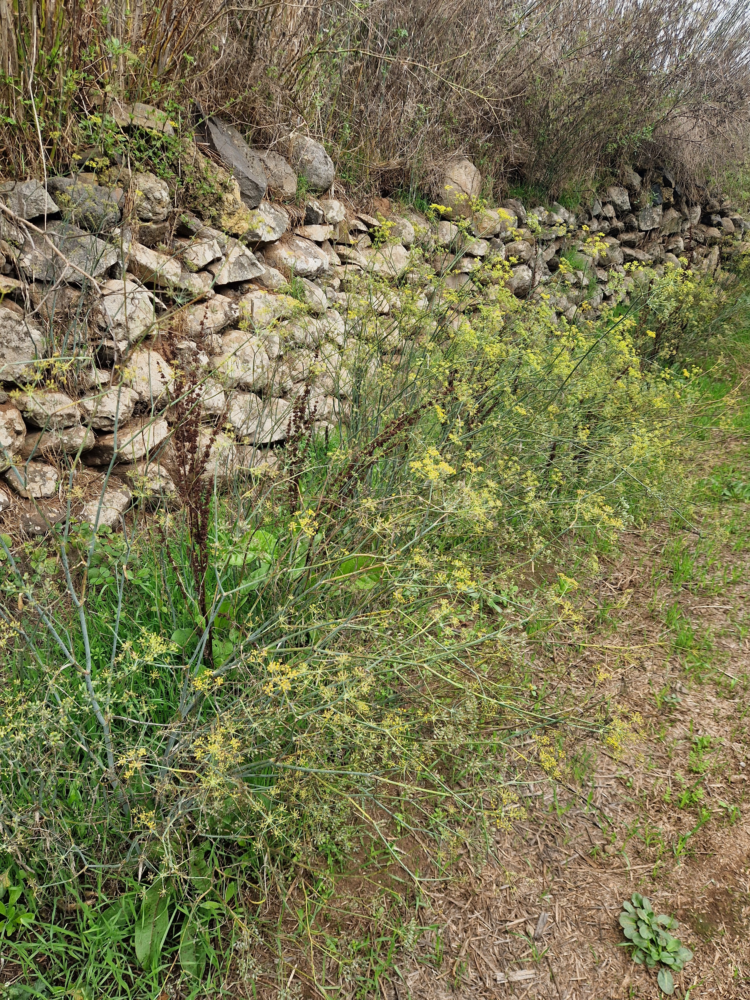
_Kohati ääristasid teed lõhnavad tillipuhmad_

Aga järved. Ühe aerofoto peal, mida kodus vaatasime, oli pruun loik. Teine allikas ütles, et järvedes ei ole aastaid vett olnud. Kuskil tee peal me igal juhul astusime ametlikust rajast kõrvale ja leidsime põõsaste tagant tiigi. Isegi veelinnud olid sees. Vesi muidugi ka. Uskumatu lugu! 

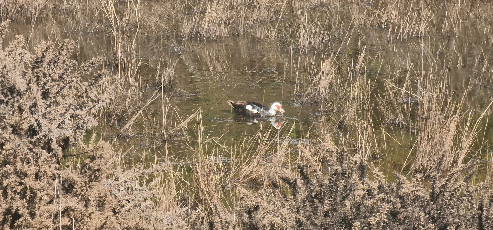
_Tähelepanelik vaatleja märkab, et linnu ümber on tõepoolest tiik_

Kuna veesilm oli sellega nähtud, pöörasime otsa ringi ja läksime metsa otsima. Hiljem kaarti uurides selgus, et see loik oli ametlikult alles soo ning päris järved olid jupp maad kaugemal. Ja tõsi - mööda mäekülge sõites silmasin orus tõesti vähe suuremat veekogu kah.

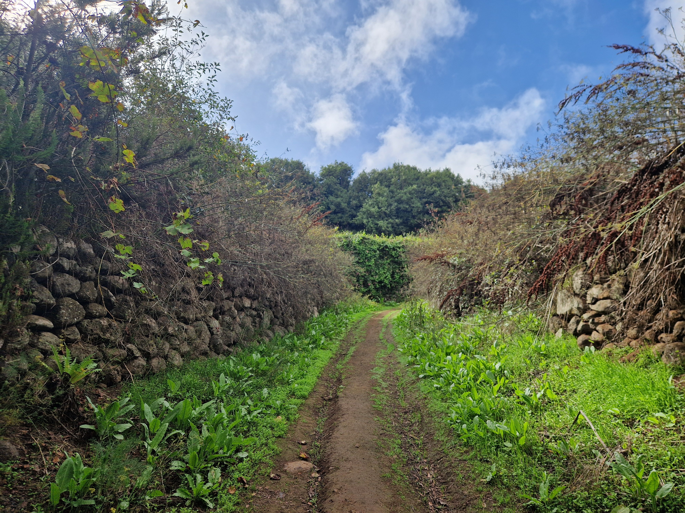
_Lebo-rada järvekeste juurde ja tagasi_

Metsani juhatas meid kõikvõimalike äppide ja kaartide asemel niisiis AI, mis ütles, et kui ma tahan loorberimetsas puid käega katsuda, aga ei taha Kirde-Tenerifele minna, siis hakaku ma aga Erjosest Monte del Agua suunas astuma ning küll see mets varsti vastu tuleb.

Pärast pisikest tõusu leidsime end parklast, mida ükski äpp meile soovitanud ei olnud ning kust läks asfalteeritud jalgrada läbi loorberimetsa Las Portelasesse. Võibolla on hea, et me ei osanud kohe sinna sõita - oleksid nii küla ise kui ka need eelmised rajakesed nägemata jäänud. Kuigi minu maitsele oli leitud jalgrada isegi natuke liiga inimtekkeline, siis loorberiteni ta kahtlemata viis ning lisaks olid tee äärde vaatamiseks välja pandud ka kaks aukartustäratava välimusega mändi.

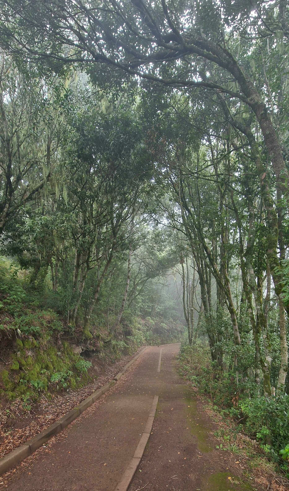
_Loorberimets Erjose lähedal_

Loorberite osas - oma mäletamist mööda ma ei olegi neid varem näinud. Muidugi oli varasemate radade ääres ka põõsa mõõtu looberipuid, kuid mets on ikkagi midagi muud. Isegi kui tegu on võrdlemisi väikse metsatukaga. Võin vaid ette kujutada, kui muinasjutulised võivad Kirde-Tenerife loorberilaaned olla.

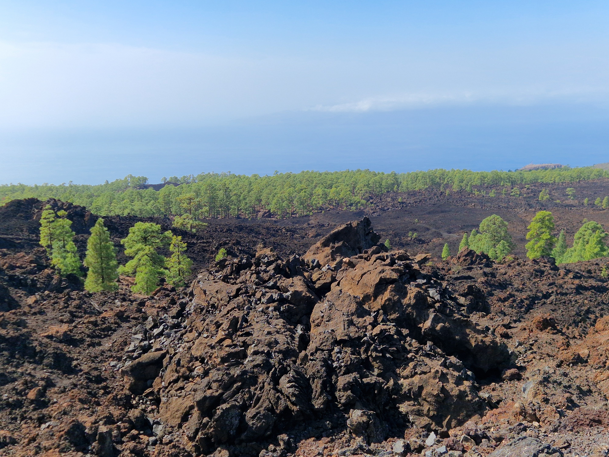
_Üks värskemaid osi Tenerifest_

Pärast metsakülastust sõitsime Teidele külla. Teada oli, et köisraudteega üles me ei saa, aga tahtsime alumisegi jaama ära näha. Erinevalt neljapäevast oli täna mõnes peatuspaigas isegi ruumi, nii et käisime näiteks Tenerife värskemaid osi ehk 1909 vulkaanipurske jälgi vaatamas.

Teide jalamil ootas meid parkimis-tohuvabohu. Kuhugi tee äärde me ennast siiski mahutasime ning suveniiripoes ja kohvikus ära käisime. 

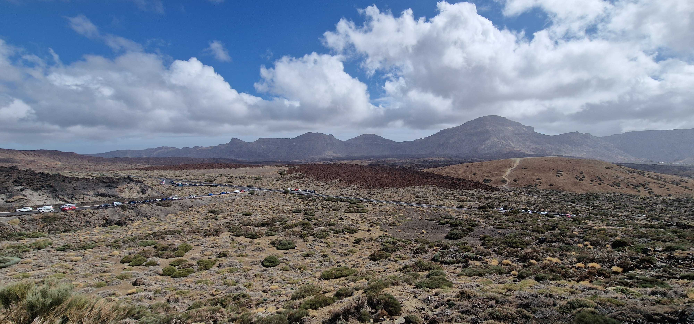
_Vaade Teide alumisest servast eelajaloolisele kaldeerale_

Vähemalt teame nüüd, kuhu teinekord lootusrikkalt sõita.

# 27. oktoober 2026, teisipäev
_Silencios, aga poolenisti välja kolinud_

## Pühapäev: Teide obs ehk astronoomiatehnika peatükk

Pühapäeval sõitsime nelja päeva jooksul kolmandat korda mäkke. Seekord kuhugi 2390 meetri kanti, Iza&ntilde;a mäe otsa, Teide observatooriumi ekskursioonile. Eelnevalt lugesin, et tegu on justkui maailma suurima päikese-observatooriumiga, aga kohapeal selgus, et tehakse siiski ka palju muud. Ja et ühtlasi on päikeseteleskoopide diameetri osas USA juba Kanaaridest ette läinud, kuigi siin loodetakse neile varsti jälle 20 sentimeetriga ära panna. Seni peavad Teide omad Euroopa suurima päikeseteleskoobi (1,5 meetrise läbimõõduga) kodukoha tiitliga leppima.

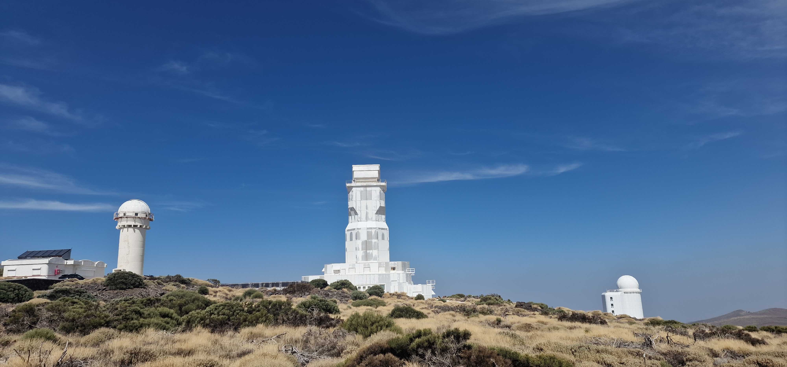
_Päikeseteleskoobid_

Varem olin muidugi kuulnud La Palma suurest teleskoobist, kus ka Eesti teadlased mõõtmisi tegemas on käinud. Selgus, et Teide obs on isegi vanem ning La Palma omaga sama katusorganisatsiooni all: Instituto de Astrofísica de Canarias.

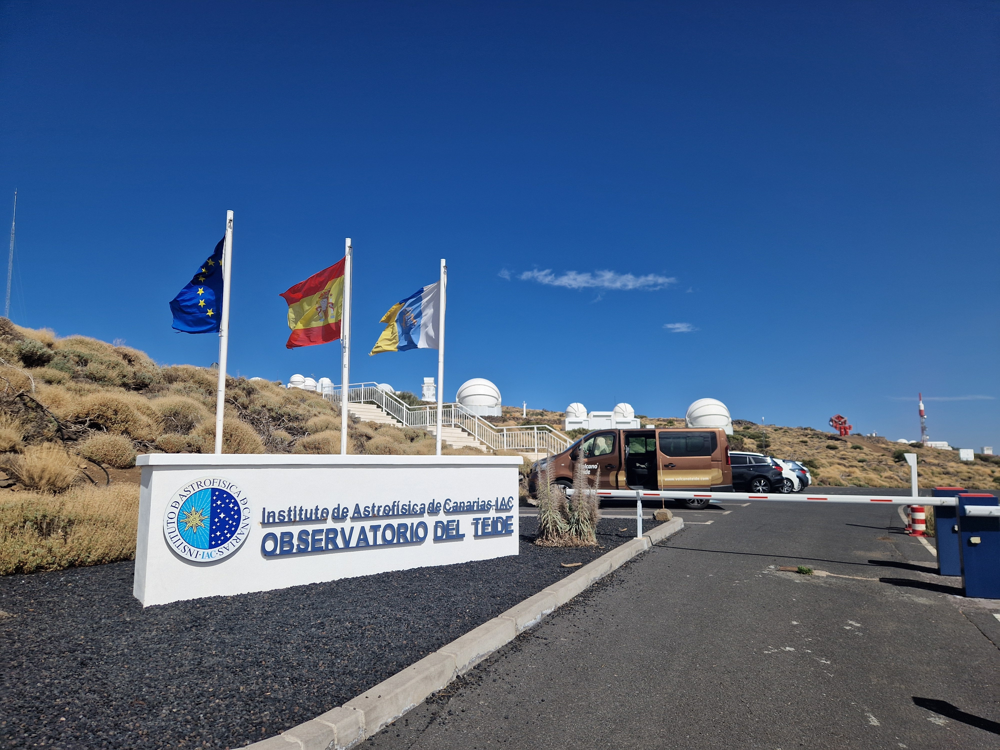
_Teide observatoorium Iza&ntilde;a mäel_

Lisaks sellele, et siinne taevas pidavat kolmesajal päeval aastast selge olema, asub Tenerife ekvaatorile meeldivalt lähedal ja valgusreostusest piisavalt kaugel. Ekvaatori lähedusest rääkides - väidetavalt pidi kuskil märtsis siit isegi Lõunarist ära paistma. Valgusreostuse vastu aitab esiteks väga hästi ookean, aga lisaks on saare peal kõik valgustusega seonduv põhjalikult reguleeritud - millise lainepikkusega pirne võib kasutada ja kui vastu maad tänavavalgustus suunatud peab olema. Kui sellest kõigest veel ei piisa, siis lisaks tekib siinkandis tihti kuhugi 1500+ meetri peale paks pilvekiht, mistõttu obs nagunii justkui omas taevases maailmas asub.

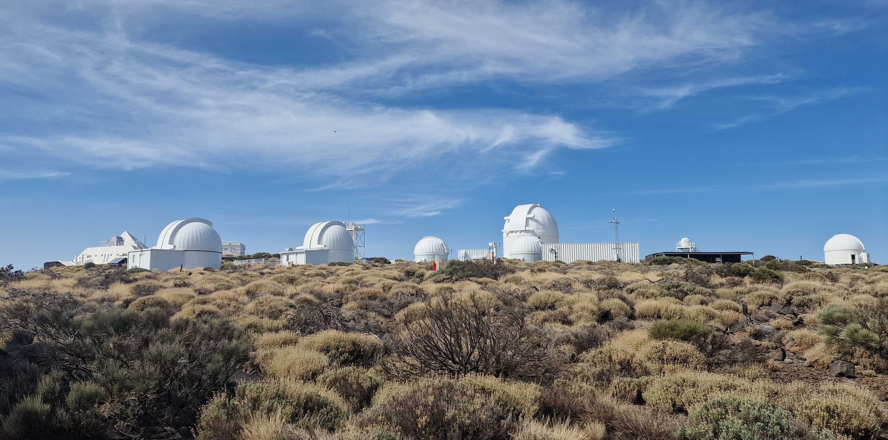
_Nunnu-kuplid_

Kõik need nunnud teleskoobikuplid ning jutt universumist, galaktikatest ja päikesest tuletasid mulle meelde, kuidas ma kunagi astronoomiks saada tahtsin. Aga noh, olnuks, võinuks, saanuks... Ekskursiooni tegi meile astronoomia-magistrant, kes otsib eksoplaneete ehk mõne teise tähe ümber tiirlevaid planeete. Küsiti ka, et kui kaugelt me otsime ning giid lajatas meile prauhti reaalsusega, et Linnuteest ja Andromedast edasi pole mõtet vaadatagi, sest inimkond ei jõuaks iialgi kaugemaid planeete vaatama minna. Kuna enne magistrandiks hakkamist olevat sama tüüp insener olnud ning tema põhifookus on hoopis kosmoseteleskoopide ehitus, siis võibolla võib teda kosmosetehnika osas isegi uskuda.

Suurte vabanduste järel tegi giid meile ka väikse PowerPointi presentatsiooni - tõesti lühikese, nii et selles hirmus ei tasu ekskursiooni vahele jätta. Muuhulgas näitas ta pilte päikeseplekkidest ja -loidetest, mis muidu oleksid võibolla mittemidagiütlevad, aga ta pani võrdluseks Maa pildi sinna kõrvale. Taaskord sain kinnitust, et me oleme ikka üks väike täpike ja ei midagi muud.

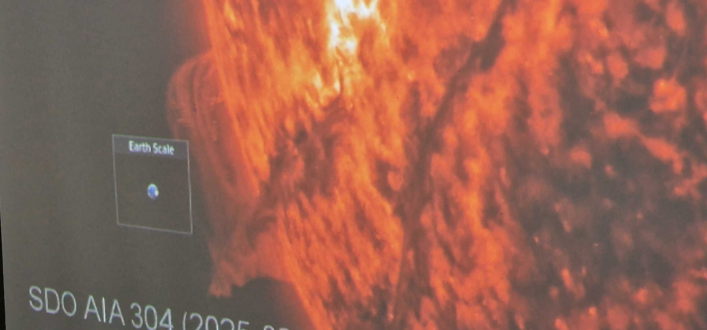{: .small}
_Päikeseloide ja "terrifyingly Earth for scale"_

Teleskoope võivad siia teatavatel tingimustel väga erinevad riigid ja institutsioonid ehitada. On nii ülikoolide ühisprojekte kui ka ülemaailmse vaatlusvõrgustiku elemente. Enamusel ei ole tänapäeval kontrollruumigi, vaid neid juhitakse puhtalt kaugteel. Muuhulgas näidati meile üht kuplikest, mille all on Sankt-Peterburi ülikooliga koostöös valminud teleskoop, millel Venemaa sõjatgevuse valguses üks päev lihtsalt juhtmed läbi lõigati ja asi vask. 

Selleks, et astronoomihakatised siiski päris eluvõõraks ei kasvaks, on üks hispaanlaste endi teleskoop tudengitele kohapeal mängimiseks. Igal teleskoobil olevat oma logo ning selle oma on tigu, sest selle ehitamine võtnud 11 aastat. Aga valmis ta sai. Ning kuigi tänapäeval antakse see teleskoop peamiselt tudengite kätte, siis 1994. aastal avastati sellega esimene pruun kääbus, mis sai nimeks Teide 1.

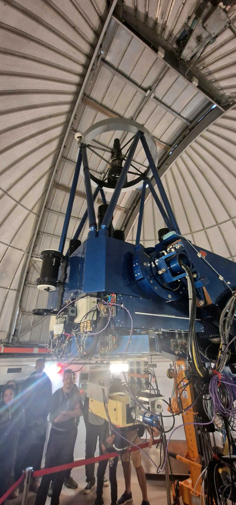
_IAC80 ehk nüüdne õppeteleskoop_

Tuuri lõpupoole taheti meile väikestest teleskoobikestest päikeseplekke ja -loiteid näidata. Plekid olid õnnetul kombel ainult päikese ühes servas. Veel õnnetumal kombel ujusid päikese ees pilved. Nii et sattusime sinna ühest neist 65-st päevast kui Teide obsis pilved on. Me Erkiga õnneks oleme sarnaseid vaateid paar aastat tagasi Greenwichis näinud, nii et vähemalt mina mingit erilist pettumust ei tundnud. Kogu ülejäänud obsi-kogemus oli sellest ühest seigast mäe kõrguselt üle (ja mägi oli teatavasti 2390 meetrine).

## Esmaspäev: pilveteki all soojas

Eile nägi taevas välja nagu kodus (päris kodus, mitte siinses kodus) - ühtlaselt helehall. Mägesid ega päikest ei olnud justkui olemaski. Ainult, et seejuures oli siin tuulevaikne ja 32 kraadi sooja. Kuna eelneval õhtul olime pilvedes ka kollast triipu märganud, hakkasime meteo-lehti mööda kolama ja saime selgeks, et nüüd on see siis käes - _calima_. See tähendab, et Saharast on kuum tuul kogu oma liivaga siiakanti tulnud. Detailsem kaart näitab, et siit ekvaatori poole ookeani peal on olukord muidugi hullem, aga ka meie kandis on väikesed hoiatused antud: ära tegele õues spordiga, kuivata pesu toas ning, kui oled astmaatik, siis kuula oma arsti. Astmaatik ma õnneks pole ning pesu ei õnnestunud ka eile asjaolude kokkusattumise tõttu pesta, aga väiksel kõrbe-rattasõidul käisin küll enne ära kui lugesin, et äkki ei olnud mõistlik. Nüüd saan vähemalt öelda, et sõit ei läinud vaevaliselt mitte sellepärast, et mina väsinud või nõrk oleksin, vaid loomulikult oli põhjuseks õhus lendlev tolm. 

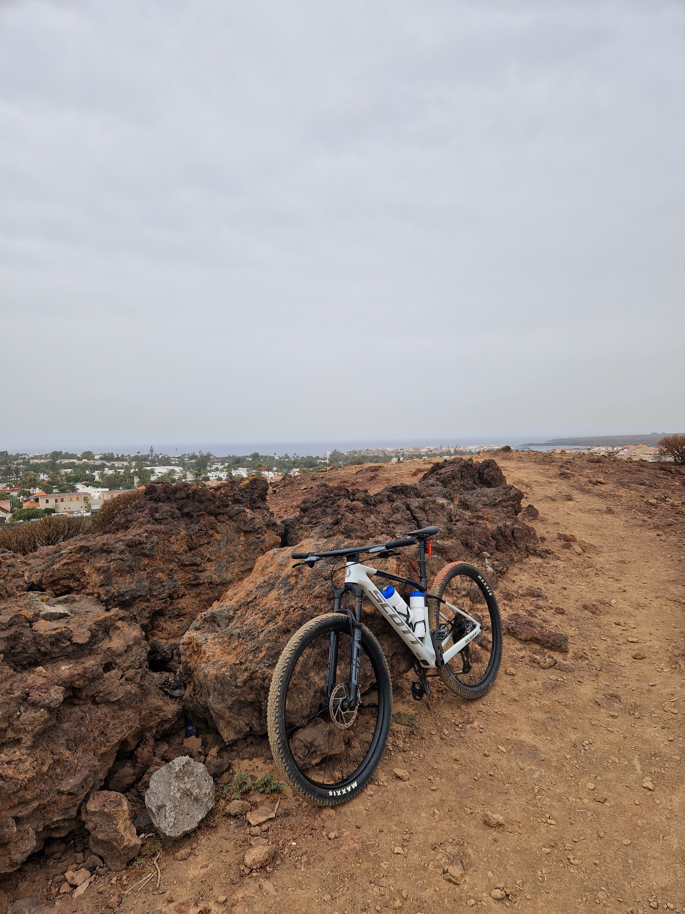
_Calima aegu õues mängimas_

## Teisipäev: segadus saarte arvuga

Nagu ma juba kuskil eespool mainisin, siis ega ma enne siia tulekut Tenerife kohta liiga palju ei lugenud. Tuleb tunnistada, et olen ka Kanaaride kohta üldiselt võrdlemisi vähe uurinud. Siit-sealt, et kus milline loodus on (sellest meie paari aasta tagune käik must-valgele Lanzarotele) ja lootus _midagigi_ teada saada nende inimeste kohta, kes siin enne hispaanlasi elasid. 

Seda, et Kanaari saari on seitse, sain ma teada alles siis, kui peatänava äärset kunstiteost guugeldasin. See kandvat nime "Seitsme saare purskkaev" ning tähistavat seitset Kanaari saart.

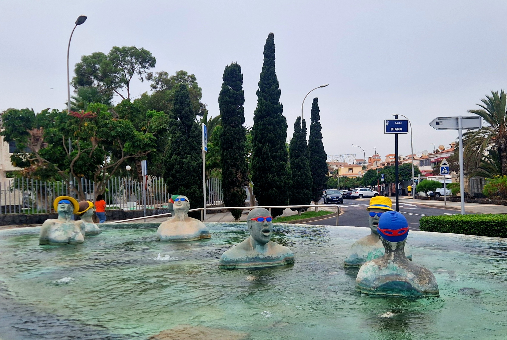
_Seitsme saare purskkaev_

Ja seda, et Kanaari saari on kaheksa, sain ma teada alles eile, kui me olude sunnil lähedalasuvasse Villa 8 Islas nimelisse majutusasutusse ümber asusime.

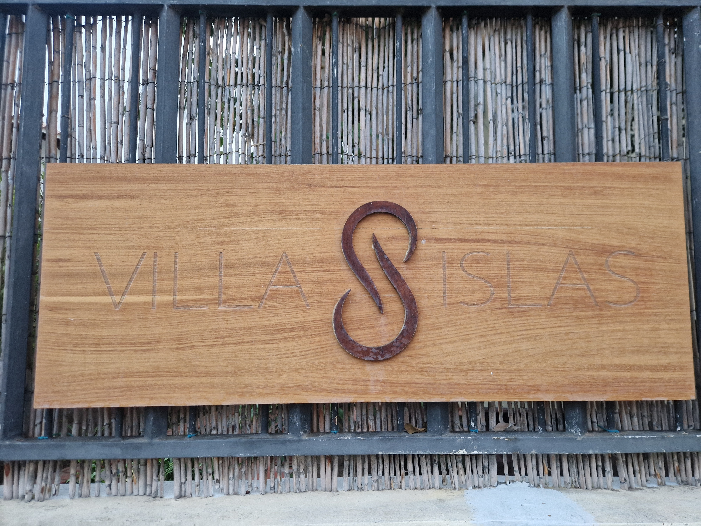{: .small}
_Kaheksa saare villa_

Kaheksa saare villas on meie toa nimi Alegranza, mis vastu kõiki ootusi ei ole üheksas Kanaari saar, vaid hoopis osa Chinijo saarestikust.

